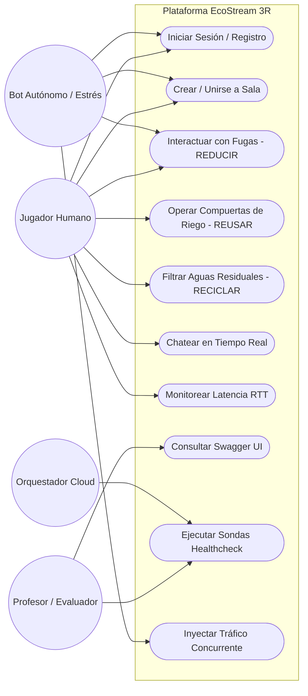
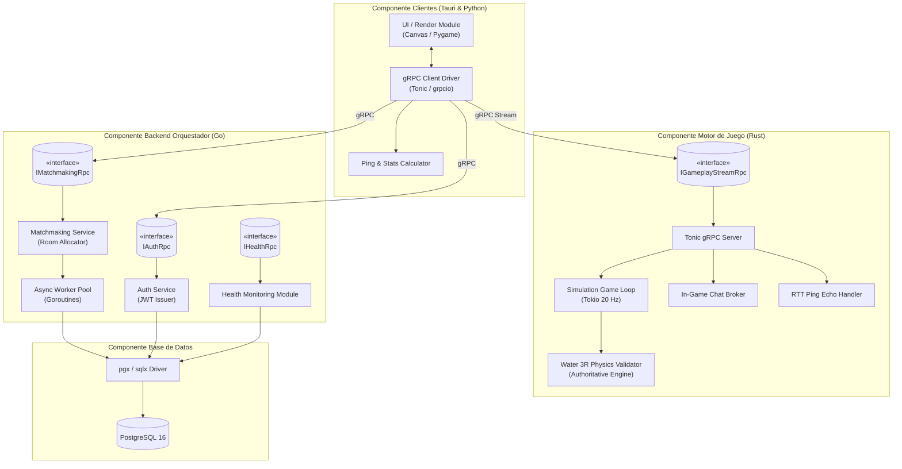
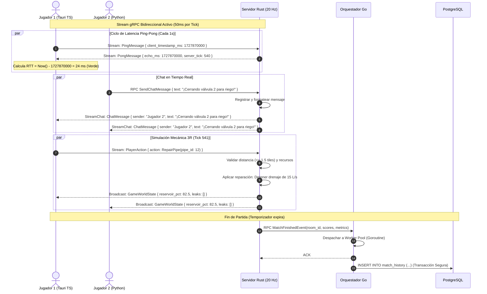
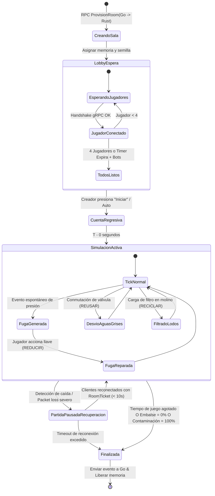

# Especificación de Arquitectura, Flujos y Guía de Diagramas UML
## EcoStream 3R - Computación en la Nube (UCAB)

Este documento detalla la estructura profunda de arquitectura, el flujo de información integral, las estrategias de balanceo de carga, la detección de fallos y la guía completa de diagramas UML para la documentación académica de la cátedra.

---

## 1. Estructura de Arquitectura del Sistema

El sistema implementa una arquitectura distribuida desacoplada en dos planos funcionales: **Control Plane (Go)** y **Data Plane (Rust)**, respaldada por una base de datos relacional (**PostgreSQL**) y consumida por dos clientes simétricos (**Tauri/TypeScript** y **Python**).

```
                      +---------------------------------------+
                      |           CLIENTES (Cross-Play)       |
                      |  [Tauri / TS]         [Python Client] |
                      +---------------------------------------+
                                  |                |
                     gRPC / HTTP/2|                |gRPC / HTTP/2
                                  v                v
                      +---------------------------------------+
                      |      CAPA DE ACCESO (DNS / lista de   |
                      |   endpoints + balanceo en el cliente) |
                      +---------------------------------------+
                                  |                |
             Control Plane (RPCs) |                | Data Plane Directo (Streaming 20Hz)
                                  v                v
        +----------------------------------+     +----------------------------------+
        |     ORQUESTADOR / GATEWAY (Go)   |     |    MOTOR DE JUEGO / SALAS (Rust) |
        | - Auth (JWT) & Users             |     | - Bucle Autoritativo (Tokio 20Hz)|
        | - Matchmaking & Room Registry    |     | - Simulación de Fluidos 3R       |
        | - Worker Pool (Goroutines)       |     | - Chat en Tiempo Real (RPC)      |
        | - Swagger UI / OpenAPI           |     | - RTT Echo (Ping-Pong)           |
        | - Health Probes (/healthz)       |     | - Tonic gRPC Bidireccional       |
        +----------------------------------+     +----------------------------------+
                   |                 |
                   | SQL Transaccional  Caché de salas
                   v                 v
        +--------------------+   +--------------------------------------------------+
        |  PostgreSQL 16     |   |          REDIS (caché de salas activas)          |
        | (Usuarios, Historial|   | Si Redis cae, Go consulta PostgreSQL             |
        |  Auditoría, Puntos)|   +--------------------------------------------------+
        +--------------------+
```

### 1.1 Responsabilidad de Componentes
1. **Control Plane (Go 1.22+)**:
   - Expone servicios gRPC y REST (vía gRPC-Gateway) con Swagger interactivo.
   - Gestiona registro, login y emisión de tickets de sala firmados (`RoomTicket`).
   - Usa un **Worker Pool basado en Goroutines** para registrar eventos en PostgreSQL de forma asíncrona sin bloquear peticiones.
   - Sensa continuamente la salud de los servicios.
2. **Data Plane (Rust / Tonic / Tokio)**:
   - Administra las salas activas y corre el bucle de juego autoritativo a 20 Ticks/segundo (50 ms por tick).
   - Valida colisiones, distancias y reglas de las 3R (anti-cheat).
   - Gestiona el **Chat en Tiempo Real** mediante un RPC de streaming dedicado (`StreamChat`/`SendChatMessage`) en el mismo servicio y canal HTTP/2, para no mezclar texto con el estado del juego a 20 Hz.
   - Emite el eco de marca de tiempo (`client_timestamp_ms`) para el cálculo de latencia RTT.
3. **Persistencia (PostgreSQL 16)**:
   - Almacena estado durable con restricciones de integridad y transacciones ACID.
4. **Clientes (Tauri/TypeScript & Python)**:
   - Simétricos, con renderizado visual sobre canvas/pygame, medición de ping visible y soporte de modo jugador humano o bot de estrés (`--bot`).

---

## 2. Flujo de Información Integral

El ciclo de vida de la información sigue 4 fases bien diferenciadas:

### Fase 1: Autenticación y Matchmaking (Control Plane)
1. El cliente envía `LoginRequest(username, password)` por un canal TLS (en producción). Nunca envía un hash calculado en el cliente.
2. Go verifica las credenciales contra PostgreSQL con **bcrypt** y genera un token JWT (HS256).
3. El cliente solicita unirse o crear una sala: `JoinOrCreateRoomRequest(room_code, mode)`.
4. Go reserva el cupo con un `UPDATE ... WHERE current_players < max_players` atómico en PostgreSQL (consultando primero la caché de salas en Redis); si se requiere un nuevo worker, notifica a Rust mediante RPC interna `ProvisionRoom(room_id, seed)`.
5. Go responde al cliente con un **`RoomTicket`** que contiene:
   - `room_id`: Identificador único de la partida.
   - `room_ticket`: token **firmado con HMAC** con `room_id`, `user_id` y expiración corta (`ROOM_TICKET_TTL`).
   - `server_endpoint`: Dirección IP y puerto directo del worker de Rust.

### Fase 2: Conexión al Juego y Handshake (Data Plane)
1. El cliente abre un canal gRPC streaming bidireccional hacia Rust: `rpc StreamGame(stream ClientStreamMessage) returns (stream ServerStreamMessage)`.
2. El primer mensaje del cliente incluye el `RoomTicket`.
3. Rust valida la firma HMAC y la expiración del ticket sin consultar a Go (desacoplamiento total). Si es inválido, cierra el stream con `UNAUTHENTICATED`.
4. Rust responde enviando el estado inicial con las dimensiones de la cuadrícula, la semilla procedimental del mapa (`map_seed`) y los identificadores de tiles (menos de 1 KB).
5. Ambos clientes reconstruyen el mapa idéntico de forma determinista.

### Fase 3: Bucle de Simulación a 20 Hz, Chat y Latencia
Cada 50 milisegundos se ejecuta un ciclo de información:
- **Cliente -> Servidor** (por el stream de juego):
  - `PlayerAction`: `MoveAction` con un **vector de intención** (`direction_x`, `direction_y`), o acción de reparación de fugas (Reducir), conmutación de válvula (Reusar) o carga de filtros (Reciclar). Moverse y actuar a la vez se envía como dos mensajes en el mismo tick.
  - `Ping`: Marca de tiempo local del cliente en milisegundos (`client_timestamp_ms`).
- **Cliente -> Servidor** (por el RPC de chat, en el mismo canal HTTP/2):
  - `SendChatMessage`: Texto emitido por el jugador (`"¡Reparen la fuga en la tubería 3!"`).
- **Servidor (Rust)**:
  - Valida física y cercanía de cada jugador con respecto al objeto interactuado.
  - Actualiza el balance hídrico: $\Delta Nivel = -\text{Consumo} - \text{Fugas} + \text{AguaReciclada}$.
  - Distribuye el mensaje de chat a los suscriptores de `StreamChat` de la sala.
- **Servidor -> Cliente (Broadcast)**:
  - `GameWorldState`: Posición de todos los jugadores, nivel de embalse (%), pureza (%), fugas activas con coordenadas y estado de válvulas.
  - `ChatMessage` (por `StreamChat`): Mensajes de texto pendientes emitidos por jugadores.
  - `Pong`: Retorna el `client_timestamp_ms` intacto + `server_tick`.
- **Cliente**:
  - Calcula latencia RTT: $\text{RTT} = \text{TiempoActual} - \text{echo\_ms}$.
  - Muestra en pantalla el HUD con nivel de agua, chat flotante y widget de ping en ms (verde/amarillo/rojo).

### Fase 4: Cierre de Partida y Persistencia Asíncrona
1. Al expirar el tiempo de la partida o vaciarse el embalse, Rust calcula los resultados finales (puntuación ecológica, litros ahorrados, litros perdidos).
2. Rust emite un `MatchFinishedEvent` hacia el Gateway Go.
3. El Gateway Go recibe el evento y lo deposita en un **canal acotado** en memoria (`chan MatchResult` con capacidad fija); si está lleno, el evento se descarta y se incrementa un contador visible en `/readyz`.
4. Una **Goroutine del Worker Pool** extrae el evento y ejecuta una transacción segura en PostgreSQL insertando el historial y recalculando los rankings de los usuarios, con reintento y backoff exponencial si PostgreSQL no responde.

---

## 3. Estrategia de Balanceo de Carga

En entornos de nube y microservicios gRPC, el balanceo de carga L4 simple (TCP) no es suficiente porque gRPC mantiene una conexión HTTP/2 multiplexada persistente. Por ello se balancea **en el cliente**, en dos niveles:

```
                      Tráfico Externo (Clientes)
                                 |
                                 v
                 [DNS / Lista de endpoints + LB en el cliente]
                                 |
                 +---------------+---------------+
                 |                               |
                 v                               v
        [Go Gateway (>= 2 réplicas)]     [Rust Engine (Partidas 20 Hz)]
        (Matchmaking & Auth)             (Directo con RoomTicket)
        (Client-Side LB / round-robin)
```

### 3.1 Nivel 1: Capa de Acceso y Balanceo en el Cliente
- **Resolución de nombres (DNS o lista de endpoints)**: devuelve las direcciones de todas las réplicas del Gateway. No se usa una IP virtual (VIP/Keepalived) porque ocultaría las réplicas detrás de una sola IP y anularía el balanceo nativo del cliente.
- **Client-Side Load Balancing (Nativo en gRPC)**:
  - Los clientes en Tauri (TypeScript) y Python utilizan el resolver nativo de gRPC (`dns:///` o lista de hosts). Si una instancia de Gateway cae, el canal gRPC del cliente conmuta automáticamente a la réplica saludable sin necesidad de proxies L7 intermedios.
- **Alternativa en nube (no se implementa)**: un balanceador L4 gestionado (NLB o equivalente) podría sustituir al DNS sin cambiar el resto de la arquitectura.

### 3.2 Nivel 2: Conexión Directa al Motor de Juego (Data Plane Desacoplado)
- Los servidores de juego en Rust son **stateful por sala** (la partida vive en la memoria de un worker específico).
- **Desacoplamiento con RoomTicket**:
  - Al unirse a una sala, el Gateway Go entrega un ticket firmado que contiene la dirección IP:Puerto directa del worker Rust asignado (`RustEndpoint`).
  - El cliente se conecta **directamente** al worker de Rust para el streaming a 20 Hz, evitando saltos de red o intermediarios que agreguen latencia.

---

## 4. Detección y Mitigación de Fallos dentro de la Plataforma

Para asegurar alta disponibilidad y resiliencia, la detección opera en 3 horizontes de tiempo:

```
+-----------------------------------------------------------------------------------+
|                           NIVELES DE DETECCIÓN DE FALLOS                          |
+-----------------------------------------------------------------------------------+
| 1. Nivel Red / Socket  (< 1000 ms) | Heartbeats TCP & HTTP/2 Ping Frames          |
| 2. Nivel Aplicación   (1 - 3 seg)  | Health Probes Activos (gRPC Health v1)       |
| 3. Nivel Lógica/Partida(2 - 5 seg) | Timeouts de Heartbeat de Sala              |
+-----------------------------------------------------------------------------------+
```

### 4.1 Mecanismos de Detección

1. **Sondas Activas de Salud (*Health Endpoint Monitoring*)**:
   - Cada nodo en Go y Rust implementa el estándar `grpc.health.v1.Health`.
   - El orquestador / Gateway ejecuta sondeos periódicos cada 2 segundos hacia los workers registrados:
     - Si un worker falla 2 sondeos consecutivos, se saca del pool de asignación en menos de 500 ms.
2. **Goroutine Heartbeat Monitor en Go**:
   - Una goroutine en segundo plano monitorea el pool de conexiones de PostgreSQL (`db.PingContext(ctx)`) y los workers de Rust registrados.
   - Si detecta que un worker de Rust no reporta estado en 3 segundos, lo declara caído.
3. **HTTP/2 Keepalive Pings**:
   - Los canales gRPC configuran parámetros Keepalive (`time: 10s`, `timeout: 3s`). Si la conexión física entre cliente y servidor se corta silenciosamente (ej. cable desconectado o caída de WiFi), el socket se destruye de inmediato en lugar de quedar en estado fantasma (*half-open connection*).

### 4.2 Mitigación y Recuperación ante Caídas

| Componente Caído | Impacto Inmediato | Detección | Estrategia de Mitigación / Auto-recuperación |
| :--- | :--- | :--- | :--- |
| **Instancia Go Gateway** | Ninguno para jugadores activos; nuevos logins atendidos por la otra réplica. | Falla de conexión en el cliente gRPC (< 1 s). | El cliente gRPC conmuta a la réplica Go sana inmediatamente. Go es stateless; no se pierde información de sesión. |
| **Worker Rust (Sala de Juego)** | Las partidas de ese worker terminan; los clientes pierden el stream. | Cierre del stream en el cliente + timeout de heartbeat en Go. | 1. Los clientes detectan el cierre y vuelven al lobby.<br>2. Go marca la sala como `FINISHED` y libera su cupo.<br>3. La restauración de la partida desde un snapshot queda como **trabajo futuro**. El historial ya guardado no se afecta. |
| **Base de Datos PostgreSQL** | Imposibilidad temporal de escribir historiales y de iniciar sesión. | Error en `db.PingContext()`. | 1. El Disyuntor (**Circuit Breaker**) se abre en Go, evitando saturar la BD.<br>2. Los eventos de fin de partida se encolan en la **cola acotada** con reintento y backoff (con contador de descartes).<br>3. Al reiniciarse el contenedor, el breaker pasa a semiabierto y el Worker Pool vacía la cola a Postgres. |
| **Redis (caché de salas)** | Búsqueda de salas algo más lenta. | Error de conexión en Go. | Go consulta directamente PostgreSQL (fuente de verdad) y repuebla la caché al recuperarse Redis. |

---

## 5. Guía Completa de Diagramas UML para Documentación

Para la entrega académica de la cátedra de Computación en la Nube, se detallan a continuación los **6 diagramas UML recomendados**, su justificación técnica, los elementos que deben contener y su especificación visual formal.

---

### Diagrama 1: Diagrama de Despliegue UML (Deployment Diagram)
- **Propósito:** Mostrar la topología física y lógica de la nube, nodos de cómputo, contenedores Docker, puertos y protocolos de red.
- **Nodos requeridos:**
  - `<<device>> Clientes`: Estaciones de trabajo corriendo Tauri y Python.
  - `<<device>> Nodo Clúster Gateway (Go)`: Contenedores con el API Gateway, Worker Pool y Swagger UI expuesto en puertos :50051 / :8080.
  - `<<device>> Nodo Clúster Simulación (Rust)`: Contenedores con Tonic gRPC y el bucle a 20 Hz expuestos en puerto :50052.
  - `<<device>> Nodo Base de Datos`: Contenedor PostgreSQL 16 con volumen persistente (una sola instancia).
  - `<<device>> Nodo Memoria / Caché`: Instancia Redis para la caché de salas activas.

```mermaid
flowchart TD
    subgraph ClientsNode["«device» Máquinas Clientes"]
        TauriClient["«artifact»\nCliente Tauri (TS)"]
        PythonClient["«artifact»\nCliente Python"]
    end

    subgraph CloudInfra["«cloud provider / virtual network» Red Privada"]
        DNSNode["«access»\nDNS / Lista de endpoints"]

        subgraph ControlPlaneNode["«device» Clúster Control Plane (Go)"]
            GoInst1["«executionEnvironment»\nGateway Go (Replica 1)\n:50051\n- Worker Pool\n- Swagger UI"]
            GoInst2["«executionEnvironment»\nGateway Go (Replica 2)\n:50051"]
        end

        subgraph DataPlaneNode["«device» Data Plane (Rust)"]
            RustWorker1["«executionEnvironment»\nRust Engine (Partidas en memoria)\n:50052\n- Tokio 20Hz\n- Chat RPC"]
        end

        subgraph StateNode["«device» Caché"]
            RedisInst["«executionEnvironment»\nRedis\n- Caché de salas activas"]
        end

        subgraph DBNode["«device» Persistencia"]
            PGPrimary[("«database»\nPostgreSQL 16\n:5432")]
        end
    end

    TauriClient -->|gRPC / HTTP/2| DNSNode
    PythonClient -->|gRPC / HTTP/2| DNSNode

    DNSNode -->|Client-Side LB / Failover| GoInst1
    DNSNode -->|Client-Side LB / Failover| GoInst2

    TauriClient -.->|gRPC Stream Directo (RoomTicket)| RustWorker1
    PythonClient -.->|gRPC Stream Directo (RoomTicket)| RustWorker1

    GoInst1 -->|ProvisionRoom / MatchFinishedEvent| RustWorker1
    GoInst2 -->|ProvisionRoom| RustWorker1

    GoInst1 --> RedisInst
    GoInst2 --> RedisInst

    GoInst1 -->|SQL ACID| PGPrimary
    GoInst2 -->|SQL ACID| PGPrimary
```

---

### Diagrama 2: Diagrama de Casos de Uso UML (Use Case Diagram)
- **Propósito:** Definir los límites del sistema desde la perspectiva de los actores (Jugador Humano, Bot Autónomo, Administrador/Profesor, Orquestador Cloud).
- **Actores:**
  - `Jugador`: Autenticarse, Crear Sala, Unirse por Código, Mover Personaje, Reparar Fugas (Reducir), Conmutar Válvulas (Reusar), Cargar Filtros (Reciclar), Enviar Mensajes de Chat, Visualizar Latencia (Ping).
  - `Bot de Estrés`: Inyectar acciones autónomas masivas para benchmarking.
  - `Administrador / Profesor`: Explorar endpoints interactivos en Swagger UI, consultar métricas de salud en `/healthz`.
  - `Orquestador de Nube`: Sondeo de sondas Liveness y Readiness.



---

### Diagrama 3: Diagrama de Componentes UML (Component Diagram)
- **Propósito:** Mostrar los módulos internos de software, sus dependencias y las interfaces gRPC (`.proto`) que los interconectan.
- **Componentes clave:**
  - `AuthService` & `MatchmakingService` (en Go).
  - `WorkerPoolManager` (Goroutines en Go).
  - `HealthChecker` (gRPC Health v1).
  - `GameLoopEngine` & `PhysicsValidator` (en Rust).
  - `ChatDispatcher` (en Rust).
  - `LatencyTracker` (en Rust).
  - Interfaces gRPC provistas: `IAuthRpc`, `IMatchmakingRpc`, `IGameplayStreamRpc`.



---

### Diagrama 4: Diagrama de Secuencia UML: Partida, Chat y Ping RTT (Sequence Diagram)
- **Propósito:** Mostrar la interacción cronológica y el intercambio de mensajes gRPC en tiempo real durante la partida.



---

### Diagrama 5: Diagrama de Secuencia UML: Tolerancia a Fallos y Circuit Breaker (Fault Tolerance Diagram)
- **Propósito:** Documentar visualmente cómo reacciona la plataforma ante la falla y recuperación de una instancia de base de datos o servidor backend.

```mermaid
sequenceDiagram
    autonumber
    participant Cliente as Clientes Conectados
    participant Gateway as Go Gateway
    participant Breaker as Disyuntor (Circuit Breaker)
    participant PG as PostgreSQL

    Note over Gateway,PG: Estado Normal: Circuit Breaker CERRADO
    Gateway->>Breaker: Ejecutar consulta / escritura
    Breaker->>PG: Query SQL
    PG-->>Breaker: OK
    Breaker-->>Gateway: Resultado Exitoso

    Note over PG: ¡FALLA CRÍTICA! Caída de PostgreSQL
    Gateway->>Breaker: Intentar registrar fin de partida
    Breaker->>PG: Query SQL
    PG--xBreaker: Connection Refused / Timeout
    Note over Breaker: Fallo 1/3 registrado

    Gateway->>Breaker: Siguiente petición
    Breaker->>PG: Query SQL
    PG--xBreaker: Timeout
    Note over Breaker: Fallo 3/3 alcanzado -> Estado ABIERTO (Open)

    Note over Gateway,Breaker: El disyuntor se activa: protege el sistema
    Gateway->>Breaker: Petición entrante
    Breaker-->>Gateway: Error Inmediato: ErrCircuitOpen (Fast-Fail sin saturar red)
    Gateway->>Gateway: Encolar evento en la cola acotada (reintento con backoff; si se llena, se cuenta el descarte)

    Note over PG: Se reinicia el contenedor de PostgreSQL
    Note over Breaker: Pasa tiempo de enfriamiento (5s) -> Estado SEMI-ABIERTO (Half-Open)
    Gateway->>Breaker: Petición de prueba (Canary probe)
    Breaker->>PG: Query de prueba
    PG-->>Breaker: OK (Éxito)
    Note over Breaker: Circuito CERRADO nuevamente. Sistema recuperado.
    Gateway->>PG: Vaciar cola de eventos encolados
```

---

### Diagrama 6: Diagrama de Estados UML del Bucle de Partida (State Machine Diagram)
- **Propósito:** Modelar los estados finitos por los que atraviesa una sala de juego en el motor autoritativo de Rust.
- **Estados:**
  - `CreandoSala`: Asignación de identificador y semilla en memoria.
  - `LobbyEspera`: Jugadores conectándose, handshake de `RoomTicket`, chat de bienvenida.
  - `CuentaRegresiva`: Todos listos, cuenta atrás de 3 segundos.
  - `SimulacionActiva`: Bucle a 20 Hz, eventos climáticos, fugas espontáneas, balance hídrico continuo.
  - `PartidaPausadaRecuperacion`: Se activa si ocurre una caída transitoria de red; espera reconexión de clientes (hasta 10s).
  - `Finalizada`: Cálculo de métricas finales, persistencia y destrucción limpia de memoria de sala.



---

## 6. Resumen de Puntos Clave para la Defensa del Proyecto

1. **Uso Lógico de Goroutines**: No se usan para cómputo intensivo (tarea delegada a Rust), sino para operaciones concurrentes I/O-bound: despacho asíncrono a PostgreSQL (Worker Pool), monitores de salud no bloqueantes y multiplexación de clientes.
2. **Sin SPOF en la Entrada**: El Gateway es stateless y está desplegado en al menos 2 réplicas; si una cae, el cliente gRPC conmuta a la otra. PostgreSQL está protegido por un Circuit Breaker con cola acotada de reintentos. La restauración de partidas en curso tras la caída de Rust y la réplica de PostgreSQL quedan como trabajo futuro (ver [ALCANCE_Y_DECISIONES.md](ALCANCE_Y_DECISIONES.md)).
3. **Mecánica 3R Clara y Jugable**: Fugas (Reducir), Riego de huertos con aguas grises (Reusar) y Molino biofiltrador (Reciclar).
4. **Chat y Ping Integrados**: Sin librerías pesadas externas; el chat usa un RPC de streaming dedicado y el ping un mensaje del stream de juego, ambos sobre el mismo canal HTTP/2, maximizando la eficiencia de red.
