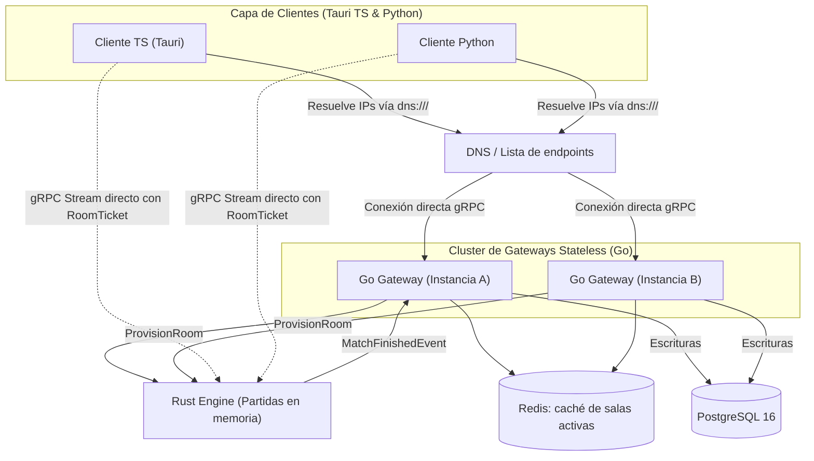
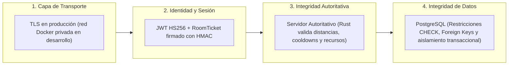
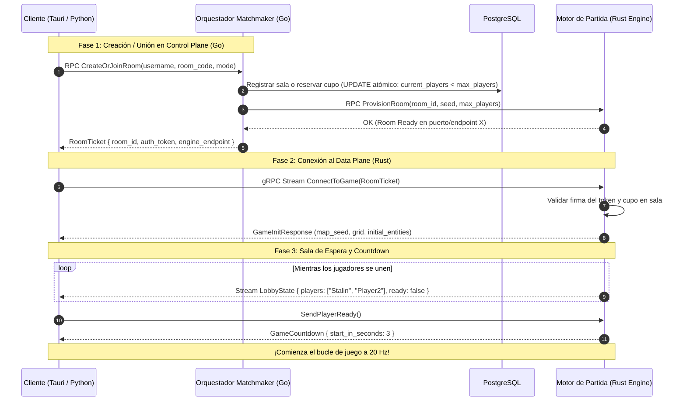

# Arquitectura y Planificación: EcoStream 3R (Ahorro de Agua)

Proyecto para la cátedra de **Computación en la Nube (UCAB - Ingeniería en Informática)**.
Juego multijugador en tiempo real enfocado en las **3R (Reducir, Reusar y Reciclar)** y el **ahorro del recurso hídrico**.

---

## 1. El Problema del Punto Único de Falla (SPOF) en la Entrada

> [!CAUTION]
> **Riesgo Identificado**: Si el Gateway (o proxy de entrada) es una única instancia física o proceso singular, su caída desconecta por completo a todos los clientes, impidiendo login, matchmaking e inicio de partidas. Esto viola los principios de alta disponibilidad en sistemas distribuidos en la nube.

Para resolver esto sin cuellos de botella se elimina el SPOF **en la entrada**: se despliegan **al menos 2 gateways stateless** y el cliente balancea entre ellos. El alcance exacto de la tolerancia a fallos (qué se protege y qué queda como trabajo futuro) está en [ALCANCE_Y_DECISIONES.md](ALCANCE_Y_DECISIONES.md).

---

## 2. Estrategia de Alta Disponibilidad para el Gateway

Se adopta **una sola estrategia** en todos los entornos (LAN, Docker multi-host o nube): **resolución por DNS (o lista de endpoints) + balanceo del lado del cliente gRPC**.

- **Resolución de nombres**: el DNS (o la configuración del cliente) devuelve las direcciones de **todas** las réplicas del Gateway Go.
- **Client-Side Load Balancing (nativo en gRPC)**: el cliente usa el resolver `dns:///` o una lista de hosts. Si un gateway no responde, el canal gRPC conmuta automáticamente a la siguiente dirección, de forma round-robin y sin intermediarios.
- **Por qué no una IP virtual (VIP)**: una VIP delante de gRPC oculta las réplicas detrás de una única IP y anula el balanceo nativo del cliente.
- **Alternativa en nube (no se implementa)**: un balanceador L4 gestionado (NLB o equivalente) puede sustituir al DNS sin cambiar el resto de la arquitectura.



---

## 3. Matriz de Resiliencia ante Fallos

| Componente que cae | Detección | Mecanismo de Recuperación | Impacto en el Usuario |
| :--- | :--- | :--- | :--- |
| **Nodo Go Gateway** | Falla de conexión en el cliente / `grpc.health.v1.Health`. | El cliente gRPC descarta la instancia caída y usa la siguiente dirección (round-robin). | Ninguno para jugadores en partida; los nuevos logins van a la otra réplica. Go es stateless. |
| **Motor de Juego Rust** | Cierre del stream gRPC en el cliente; heartbeat de salud en Go. | **La partida en curso se pierde** (restaurar estado queda como trabajo futuro). Go marca la sala como finalizada. | Los clientes vuelven al lobby. El historial ya guardado no se afecta. |
| **PostgreSQL** | Error en `db.PingContext()` y fallos consecutivos en el Circuit Breaker. | El Circuit Breaker se abre tras 3 fallos; los eventos de fin de partida esperan en una **cola acotada con reintento y backoff**, con contador de descartes. | No se pueden guardar historiales ni iniciar sesión nueva mientras dure la caída; las partidas activas continúan. |
| **Redis (caché de salas)** | Error de conexión en Go. | Go consulta directamente PostgreSQL (degradación sin pérdida de datos). | Búsqueda de salas algo más lenta. |

---

## 4. Desacoplamiento entre Control Plane y Data Plane

Para proteger aún más el sistema de una caída total:
1. **Control Plane (Go Gateway)**: Solo interviene al inicio (Login, Matchmaking, Creación de Sala) y al final (recibe el resultado de la partida).
2. **Data Plane Directo (Rust Game Loop)**:
   - Una vez que el jugador obtiene el token de sala (`RoomTicket`), el cliente se conecta **directamente al stream gRPC nativo del Rust Game Server** asignado.
   - Si el orquestador en Go cae temporalmente, **las partidas en curso en Rust continúan ejecutándose con normalidad** porque la lógica del ciclo de juego en tiempo real no depende sincrónicamente de Go.

---

## 5. El Cliente Desktop: Tauri (TypeScript) y Python Nativo

**Tauri utiliza TypeScript (Vite) para la interfaz visual y la lógica de presentación**, mientras que Python utiliza `pygame` y `grpcio`.

### Ventajas de una Arquitectura Directa sin Proxies:
1. **gRPC Nativo Directo sin Proxies Intermedios**:
   - Con **Tauri**, la UI está escrita en **TypeScript**, pero el proceso de fondo local (Tauri Core) tiene acceso a sockets de red nativos. Puede conectarse directamente por **gRPC HTTP/2 puro con streaming bidireccional** hacia los servidores Go y Rust, logrando latencia mínima y cero sobrecarga de proxies adicionales.
2. **Rendimiento y Menor Consumo de Recursos**:
   - A diferencia de Electron (que pesa cientos de megabytes y consume mucha RAM), Tauri usa el Webview nativo del sistema operativo (WebKitGTK en Linux, WebView2 en Windows), pesando unos pocos megabytes.
3. **Client-Side Load Balancing Integrado**:
   - Ambos clientes resuelven réplicas gRPC de forma nativa sin intermediarios.

---

## 6. Apartado Visual: Estética Pixel Art 2D Retro

Adoptamos una dirección de arte en **Pixel Art 2D (vista top-down 3/4)** con ambientación ecológica rural:

### 6.1 Paleta de Color y Ambiente (Rural Tech & Eco-Water)
- **Terreno y Naturaleza**:
  - Caminos de tierra batida (`#C29A64`), pasto verde natural con tonalidades cálidas (`#5A8F34` y `#7CB342`), cercas de madera rústica y flores silvestres.
- **Instalaciones de Agua**:
  - En lugar de tuberías industriales frías, los elementos encajan con el ambiente del pueblo:
    - **El Embalse / Estanque**: Estanque de agua cristalina rodeado de juncos y piedras con un muelle de madera donde se mide el nivel del agua.
    - **Reducir (Fugas en Aspersores y Canales)**: Aspersores de campo y canales de madera/cobre con fugas visibles y salpicaduras de agua (*water splashes*).
    - **Reusar (Sistemas de Riego)**: Canales de piedra y compuertas de madera que desvían aguas grises hacia parcelas de cultivos y huertos comunitarios.
    - **Reciclar (Molino de Agua y Filtros Biológicos)**: Estructura tipo molino de agua con noria de madera y tanques con lecho de arena y grava para purificación ecológica.
- **Avatares de Jugadores**:
  - Granjeros/Técnicos ecológicos con overoles de mezclilla (`denim overalls`), sombreros de paja o gorras, y una animación de 4 direcciones caminando y sosteniendo una herramienta (llave de tuerca rural o regadera).

### 6.2 Especificaciones Técnicas de los Sprites
1. **Resolución Base**:
   - Tiles de **16x16 px** (o 32x32 px escalados) con contornos limpios y técnica de pixel art nítida.
2. **Animaciones Clave**:
   - Flujo de agua con ondulaciones en estanques y canales (3 frames).
   - Efecto de salpicadura de agua cuando una tubería/canal tiene una fuga.
   - Brillo y floración en cultivos cuando reciben agua reusada exitosamente.
---

## 7. Despliegue de Red: LAN vs Servidor Propio vs Nube

### 7.1 ¿Qué pasa si los servidores se lanzan en LAN (ej. Laboratorio UCAB o Casa)?
- **Funcionamiento Nativo**:
  - Tanto gRPC como PostgreSQL operan sobre TCP/IP estándar. En una red local (LAN o WiFi compartida), el servidor Go y el servidor Rust se configuran para escuchar en `0.0.0.0:PUERTO` (en lugar de `127.0.0.1:PUERTO`).
  - Los clientes en otras máquinas de la misma red solo necesitan la **IP privada del host** (ej. `192.168.1.50:50051` o `10.x.x.x`).
  - **No se requiere conexión a Internet** para jugar en LAN.
- **Configuración mediante Variables de Entorno (`.env` / `config.yaml`)**:
  - Para que los clientes y servidores no tengan IPs "cableadas en código" (*hardcoded*), se utiliza configuración inyectada:
    - `GATEWAY_HOST=192.168.1.50` (o `localhost` o dominio de nube).
    - `GAME_SERVER_PORT=50052`.
  - Se puede implementar **mDNS / Zeroconf** (Bonjour/Avahi) para auto-descubrimiento en LAN: el cliente busca automáticamente `_ecostream._tcp.local` sin que nadie tenga que escribir una IP manualmente.

### 7.2 ¿Se necesita tener IP Pública para jugar a través de Internet con Servidor Propio?
**Respuesta directa: NO es estrictamente necesario tener IP pública fija.** Hay tres vías para resolverlo:

| Método | ¿Requiere IP Pública? | ¿Requiere Abrir Puertos en Router? | Descripción / Recomendación |
| :--- | :--- | :--- | :--- |
| **Opción A: Red Mesh Virtual (Tailscale / ZeroTier)** | **NO** | **NO** | **(Muy Recomendado para la Cátedra)**: Crea una VPN WireGuard cifrada entre tu laptop y las de tus compañeros. Todos tienen una IP privada segura (ej. `100.x.y.z`) independientemente de si están en casas distintas o detrás de CGNAT/firewalls universitarios. |
| **Opción B: Túnel Inverso (Cloudflare Tunnels / Ngrok)** | **NO** | **NO** | Expone el puerto gRPC al público a través de un túnel seguro con nombre de dominio SSL automático sin tocar el router de tu casa. |
| **Opción C: Port Forwarding Tradicional** | **SÍ** | **SÍ** | Requiere que tu proveedor de Internet (ISP) te dé una IP pública no filtrada (no CGNAT) y configurar reenvío de puertos (NAT) en tu router para los puertos gRPC (50051/50052). |
| **Opción D: VPS en la Nube (AWS EC2 / DigitalOcean / OCI Free Tier)** | **SÍ** (proporcionada por el cloud provider) | **NO en router** (solo Security Group) | Es la opción estándar de la cátedra de Computación en la Nube: se despliega un contenedor Docker en una máquina virtual de la nube con su IP pública elástica. |

---

## 8. Gestión de Seguridad e Integridad

En un sistema distribuido en tiempo real, la seguridad y la integridad se dividen en 4 capas defensivas:



El detalle de riesgos y mitigaciones está en [SEGURIDAD.md](SEGURIDAD.md).

### 8.1 Cifrado y Protección de Transporte
- **Producción / Nube**: Canales gRPC sobre TLS (HTTP/2 con ALPN `h2`) hacia los clientes.
- **Desarrollo / LAN**: Red Docker privada; gRPC puede operar sin TLS (`InsecureChannel`) o con certificados autofirmados.
- **mTLS entre servicios**: opcional en producción (trabajo futuro).
- **Secretos**: siempre por variable de entorno (`.env`), sin valores por defecto en el código ni en `docker-compose.yml`.

### 8.2 Autenticación y Autorización por Interceptores gRPC
- **Contraseñas**: el cliente envía la contraseña por un canal TLS (en producción) y el Gateway Go la verifica con **bcrypt**. Nunca se envía un hash desde el cliente, porque se convertiría en la contraseña real.
- Al iniciar sesión, el usuario recibe un **Token JWT firmado con HS256** (secreto compartido entre Go y Rust).
- **Almacenamiento seguro**: en el cliente Tauri, el JWT NO se guarda en `LocalStorage` (vulnerable a XSS), sino en el almacenamiento seguro del sistema (Tauri Stronghold / keyring).
- Cada llamada gRPC posterior viaja con el token en los metadatos HTTP/2 (`authorization: Bearer <token>`), nunca en el cuerpo de la petición.
- El **`RoomTicket`** es un token **firmado con HMAC** que incluye `room_id`, `user_id` y una expiración corta (`ROOM_TICKET_TTL`, 60 s). Rust lo valida **sin consultar a Go**.
- Tanto Go como Rust implementan un **Interceptor de Servidor (Middleware)**: si el token no existe, está alterado o expiró, la RPC se aborta con `UNAUTHENTICATED`.

### 8.3 Integridad del Estado de Juego (Cero Confianza en el Cliente / Anti-Cheat)
- **Principio**: *"Nunca confíes en el cliente"*.
- El cliente **no tiene permiso de enviar**: *"Me moví a la posición (500, 200)"* o *"Ya reparé la tubería 4"*.
- El cliente **solo envía intenciones**: un **vector de dirección** (`direction_x`, `direction_y`) o *"Presioné reparar en la tubería 4"*.
- El servidor **Rust valida autoritativamente**:
  1. **Identidad**: el `RoomTicket` es válido, no ha expirado y corresponde a esa sala.
  2. **Velocidad máxima**: el vector de dirección se normaliza y el desplazamiento por tick nunca supera `max_speed × Δt` (anti-speedhack y anti-teletransporte).
  3. **Proximidad física**: ¿Está el jugador a una distancia menor a 1.5 tiles de la tubería para repararla? Si está lejos, la acción es ignorada.
  4. **Cadencia / Rate-Limiting**: Se rechazan más de $N$ acciones por segundo para evitar ataques de denegación de servicio o flood de paquetes.

---

## 9. Flujo de Unión a Partidas: Matchmaking, Lobbies y Handshake

Para que los jugadores (tanto de TypeScript/Tauri como de Python) puedan encontrarse y jugar juntos de forma ordenada, se diseña un sistema de **Salas (Lobbies) y Handshake de Dos Fases**:



### 9.1 Métodos para Unirse a una Partida
1. **Unión por Código de Sala Privada (Room Code - ej. `AGUA-42`)**:
   - Ideal para jugar con compañeros en clase o defensas de la materia.
   - El Jugador 1 crea la sala y el sistema le da un código corto de 4 a 6 caracteres.
   - Los Jugadores 2, 3 y 4 simplemente ingresan el código para unirse a la misma instancia.
2. **Emparejamiento Rápido (Quick Match)**:
   - El jugador presiona "Partida Rápida".
   - El servicio Go busca primero en la caché de Redis (y si no está disponible, en PostgreSQL) una sala con estado `WAITING` con cupo libre (< 4 jugadores). Reserva el cupo con un `UPDATE ... WHERE current_players < max_players` atómico; si no existe ninguna sala, crea una nueva automáticamente.
3. **Inclusión de Bots**:
   - Si tras 10 segundos no se llena la sala y el creador presiona *"Iniciar con Bots"*, el gateway o el cliente lanza la señal para que el bot de Python ocupe los asientos vacíos.

---

## 10. Concurrencia en Go: Justificación y Uso Eficiente de Goroutines

### 10.1 ¿Tiene sentido lógico y es eficiente usar Goroutines aquí?
**Sí, absolutamente.** Go fue diseñado alrededor del modelo CSP (*Communicating Sequential Processes*). Las goroutines son hilos en espacio de usuario (*green threads*) que pesan apenas **2 KB** de memoria inicial (frente a 1-8 MB de un hilo de SO nativo).

### 10.2 ¿Dónde se aplican las Goroutines con propósito tangible?
1. **Dispatcher Asíncrono de Eventos y Auditoría (`Worker Pool`)**:
   - Cada vez que una partida finaliza, la persistencia en PostgreSQL no debe bloquear la respuesta gRPC. El evento entra en un **canal acotado** (`chan MatchResult` con capacidad fija) y un grupo de goroutines lo inserta en segundo plano con **reintento y backoff exponencial**. Si la cola se llena, el evento se descarta pero se **cuenta** (métrica expuesta en `/readyz`); al apagar el servicio la cola se vacía. Una cola durable (Redis Streams) queda como trabajo futuro.
2. **Heartbeat y Health Monitor Activo**:
   - Una goroutine en segundo plano con un `time.Ticker` monitorea periódicamente la salud de los servidores de juego en Rust y la base de datos PostgreSQL, actualizando una variable atómica de estado sin penalizar las peticiones de los clientes.
3. **Manejo Concurrente de Conexiones gRPC / HTTP**:
   - Cada stream y llamada RPC en `grpc-go` se despacha nativamente en su propia goroutine ligera, garantizando que una sala o jugador lento con alta latencia de red jamás bloquee a los demás.
4. **Timeouts y Cancelación Limpia con `context.Context`**:
   - Goroutines coordinadas mediante `select` y `ctx.Done()` para cancelar transacciones pendientes si un cliente se desconecta súbitamente.

---

## 11. Aplicación de 5 Patrones de Diseño Nativos de la Nube (Cloud-Native)

Se han seleccionado 5 patrones canónicos del catálogo de arquitectura en la nube (Microsoft Azure / AWS Architecture Patterns), justificados con motivos y razones palpables:

| # | Patrón Cloud-Native | Dónde se aplica en el Sistema | Motivo y Razón Palpable |
| :-: | :--- | :--- | :--- |
| **1** | **API Gateway Pattern** | Servidor Go (Clúster Stateless) | Proporciona un único punto de entrada unificado para los clientes (Tauri y Python), abstrayendo la complejidad interna de múltiples workers en Rust y PostgreSQL. Centraliza autenticación JWT, rate-limiting y enrutamiento directo. |
| **2** | **Circuit Breaker (Disyuntor)** | Cliente / Gateway Go hacia Rust y Postgres (`sony/gobreaker`) | Si el clúster de base de datos o un worker de Rust colapsa, evita inundarlo de peticiones en cascada (*cascading failure*). El disyuntor se "abre" tras 3 fallos consecutivos, devolviendo un error controlado inmediato y permitiendo que el sistema se recupere. |
| **3** | **Health Endpoint Monitoring Pattern** | Servidor Go (`/healthz`, `/readyz`, gRPC Health v1) | Permite que orquestadores de contenedores (Kubernetes / Docker Swarm / Load Balancers) sondeen si el contenedor está vivo (*Liveness*) y listo para recibir tráfico (*Readiness*). Si falla, la nube lo reinicia automáticamente. |
| **4** | **Authoritative Server Pattern** | Servidor de Simulación Rust | Patrón nativo de juegos distribuidos en red: toda la física, lógica de fluidos, cálculo de consumo de agua y validación de las 3R reside en el servidor. Evita desincronizaciones entre jugadores y hace imposible el engaño (*cheating*). |
| **5** | **Cache-Aside Pattern** | Caché de salas activas en Redis (con TTL), consultada por el Gateway Go | El listado de salas y el emparejamiento rápido se leen primero de Redis en lugar de golpear PostgreSQL en cada consulta de lobby. Si la clave no existe o Redis no responde, se lee de PostgreSQL (fuente de verdad) y se repuebla la caché. Redis nunca es un punto crítico: su caída solo hace más lenta la búsqueda de salas. |

---

## 12. Documentación con Swagger / OpenAPI y gRPC-Gateway

Para cumplir con la documentación de estándares de la industria y facilitar pruebas desde navegador (sin necesidad de herramientas gRPC dedicadas como BloomRPC/Postman gRPC):

1. **gRPC-Gateway & protoc-gen-openapiv2**:
   - A partir de los mismos archivos `.proto`, se generan automáticamente las anotaciones HTTP REST (`google.api.http`).
   - Se compila la especificación estandarizada **OpenAPI v3 / Swagger JSON**.
2. **Swagger UI Incrustado en Go**:
   - El servidor Go sirve en el endpoint `/swagger/` una interfaz gráfica interactiva de **Swagger UI** incrustada (`http.FileServer` con `embed`).
   - Permite al profesor o evaluador probar los endpoints de Login, Matchmaking, Health y Estadísticas directamente desde su navegador web haciendo clic en *"Try it out"*.

---

## 13. Monitoreo de Salud y Telemetría de Latencia (RTT Ping-Pong)

### 13.1 Monitoreo de Salud del Servidor (Server-Side Health Probes)
- **Implementación del estándar oficial gRPC**: `grpc.health.v1.Health`.
- **Endpoints de Diagnóstico**:
  - `GET /healthz` (Liveness): Verifica que el proceso Go esté respondiendo.
  - `GET /readyz` (Readiness): Verifica que la conexión con PostgreSQL y los workers de Rust estén activas.
  - Métricas de uso de Goroutines: `runtime.NumGoroutine()` expuesto para monitorear posibles fugas de memoria o fugas de goroutines (*goroutine leaks*).

### 13.2 Medición de Latencia en el Cliente en Plena Partida (RTT Display)
Para que el jugador vea en pantalla su latencia en vivo (indicador tipo `Ping: 24 ms` en verde/amarillo/rojo):
- **Mecanismo Ping-Pong de Eco en el Stream**:
  1. Cada segundo, el cliente incluye en su stream gRPC una marca de tiempo:
     ```protobuf
     message PingMessage {
       uint64 client_timestamp_ms = 1;
     }
     ```
  2. El servidor Rust devuelve esa misma marca de tiempo sin alterar en el siguiente tick del `GameWorldState`:
     ```protobuf
     message PongMessage {
       uint64 echo_client_timestamp_ms = 1;
       uint64 server_tick = 2;
     }
     ```
  3. El cliente calcula la **Latencia RTT (*Round Trip Time*)**:
     $$\text{RTT} = \text{Timestamp\_Actual} - \text{echo\_client\_timestamp\_ms}$$
  4. **Visualización en Pantalla**:
     - Tanto en **Tauri (TypeScript)** como en **Python (Pygame)**, se dibuja un widget en la esquina superior derecha:
       - **Verde**: $< 60\text{ ms}$ (Óptimo para 20 Ticks/seg).
       - **Amarillo**: $60 - 150\text{ ms}$ (Aceptable con interpolación).
       - **Rojo**: $> 150\text{ ms}$ (Alerta de pérdida de paquetes o congestión en la nube).

---

## 14. Mejoras y Optimizaciones de Arquitectura (agregado por Victor)

Para asegurar la máxima robustez y agilidad durante el ciclo de desarrollo del sistema distribuido, se incorporan las siguientes optimizaciones de ingeniería:

### 14.1 Gestión y Toolchain Automatizado de Protocol Buffers con `buf` / Makefile (agregado por Victor)
* **Problema:** En un ecosistema políglota con 4 lenguajes (Go, Rust, TypeScript, Python), la compilación manual de `.proto` con `protoc` genera inconsistencias de versión, rutas de salida desordenadas y fallos de tipado cruzado.
* **Solución:** Centralizar la compilación de contratos mediante `buf` (o un `Makefile` / script automatizado `scripts/gen_protos.sh`). Con un solo comando, se compilan y validan los stubs tipados para Go (`protoc-gen-go`), Rust (`prost` / `tonic-build`), TypeScript (`ts-proto` / `@bufbuild/protobuf`) y Python (`grpcio-tools`), garantizando total coherencia entre clientes y servidores.

### 14.2 Estrategia de Conectividad gRPC HTTP/2 Nativa en Tauri (agregado por Victor)
* **Problema:** Las aplicaciones web en navegadores tradicionales no pueden abrir sockets HTTP/2 puros arbitrarios y requieren proxies intermedios (como Envoy para gRPC-Web).
* **Solución:** Aprovechar la arquitectura de **Tauri**. En lugar de depender de proxies externos en desarrollo, el cliente utiliza el runtime nativo de Tauri (Rust Core IPC o `@grpc/grpc-js` / streaming directo HTTP/2) para conectarse directamente a los puertos gRPC de Go y Rust con latencia mínima y cero intermediarios.

### 14.3 Coordinación de Salas y Estado en PostgreSQL/Redis para Gateways 100% Stateless (agregado por Victor)
* **Problema:** Si dos instancias de Gateway en Go están activas, un jugador puede crear una sala en el Gateway 1 y otro jugador puede intentar unirse a través del Gateway 2.
* **Solución:** Ningún Gateway almacenará el mapa de salas en su memoria RAM local aislada. La asignación de sala (`RoomID -> RustWorkerEndpoint`) se registra en **PostgreSQL (fuente de verdad)** con estados (`WAITING`, `RUNNING`, `FINISHED`) y el cupo se reserva con un `UPDATE ... WHERE current_players < max_players` atómico. **Redis solo actúa como caché de lectura** de las salas activas. Esto garantiza que cualquier Gateway pueda despachar a los clientes a la sala y worker de Rust correspondiente sin importar por qué réplica ingresaron.

### 14.4 Protocolo de Reconexión Transitoria y Resiliencia a Microcortes (Tickets de Sesión) (agregado por Victor)
* **Problema:** En redes Wi-Fi o conexiones con fluctuaciones de señal, una pérdida de socket TCP por 1 o 2 segundos expulsaría al jugador de la partida en el servidor autoritativo de Rust.
* **Solución:** Se implementa un **`reconnect_ticket`** temporal (token aleatorio de al menos 128 bits) con un tiempo de gracia único de **10 segundos** (`RECONNECT_GRACE_SECONDS`, *Grace Period*). Este mecanismo cubre **micro-cortes de red del cliente**; no cubre la caída del servidor Rust (la partida se pierde, ver §3). Durante este lapso:
  1. El cliente muestra un mensaje de "Reconectando..." y reintenta con *Exponential Backoff* contra el mismo endpoint de Rust.
  2. El servidor Rust mantiene al jugador en estado `DISCONNECTED_WAITING`, conservando su entidad y posición en el bucle de simulación.
  3. Si el cliente reestablece el stream gRPC presentando su ticket, el motor de Rust le envía de inmediato un **Snapshot de Reconciliación** con el estado actual del mundo hídrico y reanuda el envío de ticks sin reiniciar la sesión. Si vence la gracia, el jugador se elimina de la sala.

