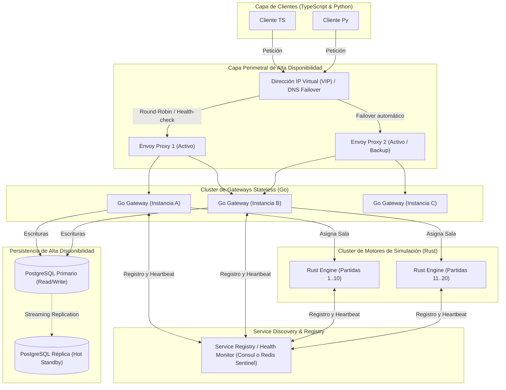
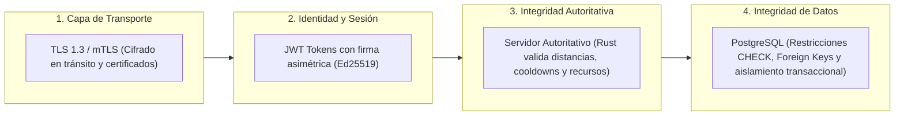
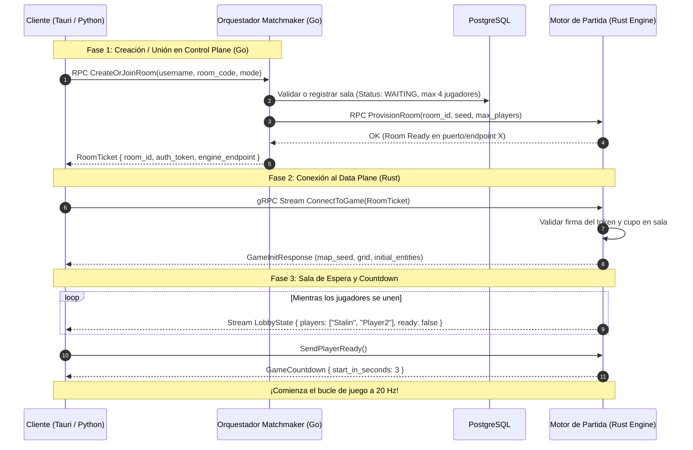

# Arquitectura y Planificación: EcoStream 3R (Ahorro de Agua)

Proyecto para la cátedra de **Computación en la Nube (UCAB - Ingeniería en Informática)**.
Juego multijugador en tiempo real enfocado en las **3R (Reducir, Reusar y Reciclar)** y el **ahorro del recurso hídrico**.

---

## 1. El Problema del Punto Único de Falla (SPOF) en la Entrada

> [!CAUTION]
> **Riesgo Identificado**: Si el Gateway (o proxy de entrada) es una única instancia física o proceso singular, su caída desconecta por completo a todos los clientes, impidiendo login, matchmaking e inicio de partidas. Esto viola los principios de alta disponibilidad en sistemas distribuidos en la nube.

Para resolver esto sin cuellos de botella ni caídas catastróficas, se implementa una arquitectura **Zero Single Point of Failure (Zero-SPOF)**.

---

## 2. Estrategia de Alta Disponibilidad para el Gateway / Ingress

Dependiendo del entorno de despliegue (Nube gestionada o Infraestructura propia/Docker), se contemplan dos soluciones estándar de la industria:

### 2.1 En Nube (AWS, GCP, Azure, OCI)
- **Layer 4 / Layer 7 Managed Load Balancer (NLB / ALB / Cloud Load Balancing)**:
  - El proveedor de nube asigna una dirección IP virtual (VIP) altamente distribuida backed por BGP Anycast en múltiples Availability Zones (AZs).
  - Distribuye el tráfico entrante a un grupo de autoescalado (**Auto Scaling Group / Deployment**) de réplicas de Gateway Envoy/Go.

### 2.2 En Entorno Universitario / Bare-Metal / Docker Multi-Host
- **VRRP / IP Flotante (Keepalived / CARP)** o **DNS Round-Robin con Health Checks**:
  - Dos o más instancias de Proxy/Gateway comparten una **IP Virtual (VIP)**.
  - Si el nodo primario falla o deja de responder al heartbeat en menos de 1 segundo, el nodo secundario toma la IP flotante automáticamente vía gratuitous ARP.
- **Client-Side Load Balancing (Nativo en gRPC)**:
  - gRPC posee capacidades nativas de resolución de nombres (`dns:///` o Service Discovery tipo Consul/CoreDNS).
  - El cliente recibe una lista de endpoints backend vivos. Si un gateway o servidor no responde, el canal gRPC del cliente conmuta automáticamente a la siguiente dirección de la lista sin intervención del usuario.



---

## 3. Matriz de Resiliencia ante Fallos

| Componente que cae | Detección | Mecanismo de Recuperación | Impacto en el Usuario |
| :--- | :--- | :--- | :--- |
| **Proxy / Ingress Primario** | Health checks L4/L7 o Keepalived VRRP (< 1s). | La IP Virtual migra al proxy secundario; DNS conmutado. | Reconexión transparente de socket (< 500ms). |
| **Nodo Go Gateway** | Health check gRPC `/grpc.health.v1.Health/Check`. | El proxy retira la instancia del pool y despacha a las réplicas restantes. | Ninguno (Go es stateless; la sesión está en token/DB). |
| **Motor de Juego Rust** | Pérdida de heartbeat en Service Registry (timeout > 2s). | El Gateway Go detecta la ausencia, inicializa un nuevo worker Rust y restaura el último checkpoint de la partida. | Pausa breve de 1 a 2 segundos en el tick del juego con sincronización inmediata. |
| **PostgreSQL Primario** | Patroni / PgBouncer / Keepalived monitor. | Promoción automática de la réplica `Hot Standby` a Primario. | Breve rechazo de escrituras durante la elección (1-3s), lecturas continúan. |

---

## 4. Desacoplamiento entre Control Plane y Data Plane

Para proteger aún más el sistema de una caída total:
1. **Control Plane (Go Gateway)**: Solo interviene al inicio (Login, Matchmaking, Creación de Sala).
2. **Data Plane Directo (Rust Game Loop)**:
   - Una vez que el jugador obtiene el token de sala (`RoomTicket`), el cliente puede conectarse **directamente al stream gRPC del Rust Game Server** asignado (o a través del proxy Envoy que balancea por cabecera `X-Room-ID`).
   - Si el orquestador en Go cae temporalmente, **las partidas en curso en Rust continúan ejecutándose con normalidad** porque la lógica del ciclo de juego en tiempo real no depende sincrónicamente de Go.

---

## 5. El Cliente TypeScript: ¿Tauri vs Navegador Web Puro?

Efectivamente, **Tauri utiliza TypeScript (React, Vue, Svelte o Vanilla TS/Vite) para toda la interfaz visual y lógica de presentación**.

### ¿Por qué Tauri es una opción superior para este proyecto?
1. **gRPC Nativo sin Envoy Proxy en el Cliente**:
   - En navegadores web estándar (Chrome/Firefox), no existe acceso a sockets HTTP/2 arbitrarios, obligando a usar `gRPC-Web` + un proxy traductor (Envoy).
   - Con **Tauri**, la UI está escrita en **TypeScript**, pero el proceso de fondo local (Tauri Core) corre en Rust y tiene acceso a sockets de red nativos. Puede conectarse directamente por **gRPC HTTP/2 puro con streaming bidireccional** hacia los servidores Go y Rust, eliminando la necesidad de Envoy para el cliente de escritorio.
2. **Rendimiento y Menor Consumo de Recursos**:
   - A diferencia de Electron (que pesa cientos de megabytes y consume mucha RAM), Tauri usa el Webview nativo del sistema operativo (WebKitGTK en Linux, WebView2 en Windows), pesando unos pocos megabytes.
---

---

## 7. Apartado Visual: Estética Pixel Art 2D Retro

Adoptamos una dirección de arte en **Pixel Art 2D (vista top-down 3/4)** con ambientación ecológica rural:

### 7.1 Paleta de Color y Ambiente (Rural Tech & Eco-Water)
- **Terreno y Naturaleza**:
  - Caminos de tierra batida (`#C29A64`), pasto verde natural con tonalidades cálidas (`#5A8F34` y `#7CB342`), cercas de madera rústica y flores silvestres.
- **Instalaciones de Agua**:
  - En lugar de tuberías industriales frías, los elementos encajan con el ambiente del pueblo:
    - **El Embalse / Estanque**: Estanque de agua cristalina rodeado de juncos y piedras con un muelle de madera donde se mide el nivel del agua.
    - **Reducir (Fugas en Aspersores y Canales)**: Aspersores de campo y canales de madera/cobre con fugas visibles y salpicaduras de agua (*water splashes*).
    - **Reusar (Sistemas de Riego)**: Canales de piedra y compuertas de madera que desvían aguas grises hacia parcelas de cultivos y huertos comunitarios.
    - **Reciclar (Molino de Agua y Filtros Biológicos)**: Estructura tipo molino de agua con noria de madera y tanques con lecho de arena y grava para purificación ecológica.
- **Avatares de Jugadores**:
  - Granjeros/Técnicos ecológicos con overoles de mezclilla (`denim overalls`), sombreros de paja o gorras, y una animación de 4 direcciones caminando y sosteniendo una herramienta (llave de tuerca rural o regadera).

### 7.2 Especificaciones Técnicas de los Sprites
1. **Resolución Base**:
   - Tiles de **16x16 px** (o 32x32 px escalados) con contornos limpios y técnica de pixel art nítida.
2. **Animaciones Clave**:
   - Flujo de agua con ondulaciones en estanques y canales (3 frames).
   - Efecto de salpicadura de agua cuando una tubería/canal tiene una fuga.
   - Brillo y floración en cultivos cuando reciben agua reusada exitosamente.
---

## 9. Despliegue de Red: LAN vs Servidor Propio vs Nube

### 9.1 ¿Qué pasa si los servidores se lanzan en LAN (ej. Laboratorio UCAB o Casa)?
- **Funcionamiento Nativo**:
  - Tanto gRPC como PostgreSQL operan sobre TCP/IP estándar. En una red local (LAN o WiFi compartida), el servidor Go y el servidor Rust se configuran para escuchar en `0.0.0.0:PUERTO` (en lugar de `127.0.0.1:PUERTO`).
  - Los clientes en otras máquinas de la misma red solo necesitan la **IP privada del host** (ej. `192.168.1.50:50051` o `10.x.x.x`).
  - **No se requiere conexión a Internet** para jugar en LAN.
- **Configuración mediante Variables de Entorno (`.env` / `config.yaml`)**:
  - Para que los clientes y servidores no tengan IPs "cableadas en código" (*hardcoded*), se utiliza configuración inyectada:
    - `GATEWAY_HOST=192.168.1.50` (o `localhost` o dominio de nube).
    - `GAME_SERVER_PORT=50052`.
  - Se puede implementar **mDNS / Zeroconf** (Bonjour/Avahi) para auto-descubrimiento en LAN: el cliente busca automáticamente `_ecostream._tcp.local` sin que nadie tenga que escribir una IP manualmente.

### 9.2 ¿Se necesita tener IP Pública para jugar a través de Internet con Servidor Propio?
**Respuesta directa: NO es estrictamente necesario tener IP pública fija.** Hay tres vías para resolverlo:

| Método | ¿Requiere IP Pública? | ¿Requiere Abrir Puertos en Router? | Descripción / Recomendación |
| :--- | :--- | :--- | :--- |
| **Opción A: Red Mesh Virtual (Tailscale / ZeroTier)** | **NO** | **NO** | **(Muy Recomendado para la Cátedra)**: Crea una VPN WireGuard cifrada entre tu laptop y las de tus compañeros. Todos tienen una IP privada segura (ej. `100.x.y.z`) independientemente de si están en casas distintas o detrás de CGNAT/firewalls universitarios. |
| **Opción B: Túnel Inverso (Cloudflare Tunnels / Ngrok)** | **NO** | **NO** | Expone el puerto gRPC al público a través de un túnel seguro con nombre de dominio SSL automático sin tocar el router de tu casa. |
| **Opción C: Port Forwarding Tradicional** | **SÍ** | **SÍ** | Requiere que tu proveedor de Internet (ISP) te dé una IP pública no filtrada (no CGNAT) y configurar reenvío de puertos (NAT) en tu router para los puertos gRPC (50051/50052). |
| **Opción D: VPS en la Nube (AWS EC2 / DigitalOcean / OCI Free Tier)** | **SÍ** (proporcionada por el cloud provider) | **NO en router** (solo Security Group) | Es la opción estándar de la cátedra de Computación en la Nube: se despliega un contenedor Docker en una máquina virtual de la nube con su IP pública elástica. |

---

## 10. Gestión de Seguridad e Integridad

En un sistema distribuido en tiempo real, la seguridad y la integridad se dividen en 4 capas defensivas:



### 10.1 Cifrado y Protección de Transporte (TLS / mTLS)
- **Producción / Nube**: Canales gRPC sobre TLS (HTTP/2 con ALPN `h2`). Se pueden usar certificados gratuitos de Let's Encrypt o Cloudflare.
- **Desarrollo / LAN**: gRPC permite operar en modo inseguro (`InsecureChannel`) para simplificar pruebas rápidas en laboratorio, o generar certificados autofirmados mediante un script `make certs`.

### 10.2 Autenticación y Autorización por Interceptores gRPC
- Al iniciar sesión en el Gateway Go, el usuario recibe un **Token JWT** firmado que contiene su `user_id`, `username` y `room_id`.
- Cada llamada gRPC posterior del cliente (tanto en Tauri como en Python) viaja con el token en los metadatos HTTP/2 (`authorization: Bearer <token>`).
- Tanto Go como Rust implementan un **Interceptor de Servidor (Middleware)**: si el token no existe, está alterado o expiró, la RPC se aborta inmediatamente con código de error gRPC `UNAUTHENTICATED`.

### 10.3 Integridad del Estado de Juego (Cero Confianza en el Cliente / Anti-Cheat)
- **Principio**: *"Nunca confíes en el cliente"*.
- El cliente **no tiene permiso de enviar**: *"Me moví a la posición (500, 200)"* o *"Ya reparé la tubería 4"*.
- El cliente **solo envía vectores de intención**: *"Quiero moverme a la derecha"* o *"Presioné reparar en la tubería 4"*.
- El servidor **Rust valida autoritativamente**:
  1. **Velocidad máxima**: ¿Es físicamente posible que el jugador se mueva a esa posición en 50ms? Si no, se descarta (anti-speedhack).
  2. **Proximidad física**: ¿Está el jugador a una distancia menor a 1.5 tiles de la tubería para repararla? Si está lejos, la acción es ignorada.
  3. **Cadencia / Rate-Limiting**: Se rechazan más de $N$ acciones por segundo para evitar ataques de denegación de servicio o flood de paquetes.

---

## 11. Flujo de Unión a Partidas: Matchmaking, Lobbies y Handshake

Para que los jugadores (tanto de TypeScript/Tauri como de Python) puedan encontrarse y jugar juntos de forma ordenada, se diseña un sistema de **Salas (Lobbies) y Handshake de Dos Fases**:



### 11.1 Métodos para Unirse a una Partida
1. **Unión por Código de Sala Privada (Room Code - ej. `AGUA-42`)**:
   - Ideal para jugar con compañeros en clase o defensas de la materia.
   - El Jugador 1 crea la sala y el sistema le da un código corto de 4 a 6 caracteres.
   - Los Jugadores 2, 3 y 4 simplemente ingresan el código para unirse a la misma instancia.
2. **Emparejamiento Rápido (Quick Match)**:
   - El jugador presiona "Partida Rápida".
   - El servicio Go busca en PostgreSQL/Memoria una sala con estado `WAITING` con cupo libre (< 4 jugadores) y lo empareja al instante; si no existe ninguna, crea una nueva automáticamente.
3. **Inclusión de Bots**:
   - Si tras 10 segundos no se llena la sala y el creador presiona *"Iniciar con Bots"*, el gateway o el cliente lanza la señal para que el bot de Python ocupe los asientos vacíos.

---

## 12. Concurrencia en Go: Justificación y Uso Eficiente de Goroutines

### 12.1 ¿Tiene sentido lógico y es eficiente usar Goroutines aquí?
**Sí, absolutamente.** Go fue diseñado alrededor del modelo CSP (*Communicating Sequential Processes*). Las goroutines son hilos en espacio de usuario (*green threads*) que pesan apenas **2 KB** de memoria inicial (frente a 1-8 MB de un hilo de SO nativo).

### 12.2 ¿Dónde se aplican las Goroutines con propósito tangible?
1. **Dispatcher Asíncrono de Eventos y Auditoría (`Worker Pool`)**:
   - Cada vez que una partida finaliza o un jugador sube de nivel, la persistencia en PostgreSQL no debe bloquear la respuesta gRPC. Una goroutine toma el evento de un canal en búfer (`chan MatchResult`) y realiza la inserción por lotes (*batch insert*) en segundo plano.
2. **Heartbeat y Health Monitor Activo**:
   - Una goroutine en segundo plano con un `time.Ticker` monitorea periódicamente la salud de los servidores de juego en Rust y la base de datos PostgreSQL, actualizando una variable atómica de estado sin penalizar las peticiones de los clientes.
3. **Manejo Concurrente de Conexiones gRPC / HTTP**:
   - Cada stream y llamada RPC en `grpc-go` se despacha nativamente en su propia goroutine ligera, garantizando que una sala o jugador lento con alta latencia de red jamás bloquee a los demás.
4. **Timeouts y Cancelación Limpia con `context.Context`**:
   - Goroutines coordinadas mediante `select` y `ctx.Done()` para cancelar transacciones pendientes si un cliente se desconecta súbitamente.

---

## 13. Aplicación de 5 Patrones de Diseño Nativos de la Nube (Cloud-Native)

Se han seleccionado 5 patrones canónicos del catálogo de arquitectura en la nube (Microsoft Azure / AWS Architecture Patterns), justificados con motivos y razones palpables:

| # | Patrón Cloud-Native | Dónde se aplica en el Sistema | Motivo y Razón Palpable |
| :-: | :--- | :--- | :--- |
| **1** | **API Gateway Pattern** | Servidor Go + Envoy Proxy | Proporciona un único punto de entrada unificado para los clientes (Tauri y Python), abstrayendo la complejidad interna de múltiples workers en Rust y PostgreSQL. Centraliza autenticación JWT, rate-limiting y enrutamiento. |
| **2** | **Circuit Breaker (Disyuntor)** | Cliente / Gateway Go hacia Rust y Postgres (`sony/gobreaker`) | Si el clúster de base de datos o un worker de Rust colapsa, evita inundarlo de peticiones en cascada (*cascading failure*). El disyuntor se "abre" tras 3 fallos consecutivos, devolviendo un error controlado inmediato y permitiendo que el sistema se recupere. |
| **3** | **Health Endpoint Monitoring Pattern** | Servidor Go (`/healthz`, `/readyz`, gRPC Health v1) | Permite que orquestadores de contenedores (Kubernetes / Docker Swarm / Load Balancers) sondeen si el contenedor está vivo (*Liveness*) y listo para recibir tráfico (*Readiness*). Si falla, la nube lo reinicia automáticamente. |
| **4** | **Authoritative Server Pattern** | Servidor de Simulación Rust | Patrón nativo de juegos distribuidos en red: toda la física, lógica de fluidos, cálculo de consumo de agua y validación de las 3R reside en el servidor. Evita desincronizaciones entre jugadores y hace imposible el engaño (*cheating*). |
| **5** | **Cache-Aside / Materialized State Pattern** | Caché de Estado Rápido (Go/Memoria compartida) | El estado de las salas activas y el emparejamiento rápido se consulta en memoria/caché atómica en lugar de golpear PostgreSQL en cada tick o consulta de lobby. Solo cuando la sala finaliza o cambia de estado crítico se escribe a Postgres. |

---

## 14. Documentación con Swagger / OpenAPI y gRPC-Gateway

Para cumplir con la documentación de estándares de la industria y facilitar pruebas desde navegador (sin necesidad de herramientas gRPC dedicadas como BloomRPC/Postman gRPC):

1. **gRPC-Gateway & protoc-gen-openapiv2**:
   - A partir de los mismos archivos `.proto`, se generan automáticamente las anotaciones HTTP REST (`google.api.http`).
   - Se compila la especificación estandarizada **OpenAPI v3 / Swagger JSON**.
2. **Swagger UI Incrustado en Go**:
   - El servidor Go sirve en el endpoint `/swagger/` una interfaz gráfica interactiva de **Swagger UI** incrustada (`http.FileServer` con `embed`).
   - Permite al profesor o evaluador probar los endpoints de Login, Matchmaking, Health y Estadísticas directamente desde su navegador web haciendo clic en *"Try it out"*.

---

## 15. Monitoreo de Salud y Telemetría de Latencia (RTT Ping-Pong)

### 15.1 Monitoreo de Salud del Servidor (Server-Side Health Probes)
- **Implementación del estándar oficial gRPC**: `grpc.health.v1.Health`.
- **Endpoints de Diagnóstico**:
  - `GET /healthz` (Liveness): Verifica que el proceso Go esté respondiendo.
  - `GET /readyz` (Readiness): Verifica que la conexión con PostgreSQL y los workers de Rust estén activas.
  - Métricas de uso de Goroutines: `runtime.NumGoroutine()` expuesto para monitorear posibles fugas de memoria o fugas de goroutines (*goroutine leaks*).

### 15.2 Medición de Latencia en el Cliente en Plena Partida (RTT Display)
Para que el jugador vea en pantalla su latencia en vivo (indicador tipo `Ping: 24 ms` en verde/amarillo/rojo):
- **Mecanismo Ping-Pong de Eco en el Stream**:
  1. Cada segundo, el cliente incluye en su stream gRPC una marca de tiempo:
     ```protobuf
     message PingMessage {
       uint64 client_timestamp_ms = 1;
     }
     ```
  2. El servidor Rust devuelve esa misma marca de tiempo sin alterar en el siguiente tick del `GameWorldState`:
     ```protobuf
     message PongMessage {
       uint64 echo_client_timestamp_ms = 1;
       uint64 server_tick = 2;
     }
     ```
  3. El cliente calcula la **Latencia RTT (*Round Trip Time*)**:
     $$\text{RTT} = \text{Timestamp\_Actual} - \text{echo\_client\_timestamp\_ms}$$
  4. **Visualización en Pantalla**:
     - Tanto en **Tauri (TypeScript)** como en **Python (Pygame)**, se dibuja un widget en la esquina superior derecha:
       - **Verde**: $< 60\text{ ms}$ (Óptimo para 20 Ticks/seg).
       - **Amarillo**: $60 - 150\text{ ms}$ (Aceptable con interpolación).
       - **Rojo**: $> 150\text{ ms}$ (Alerta de pérdida de paquetes o congestión en la nube).


