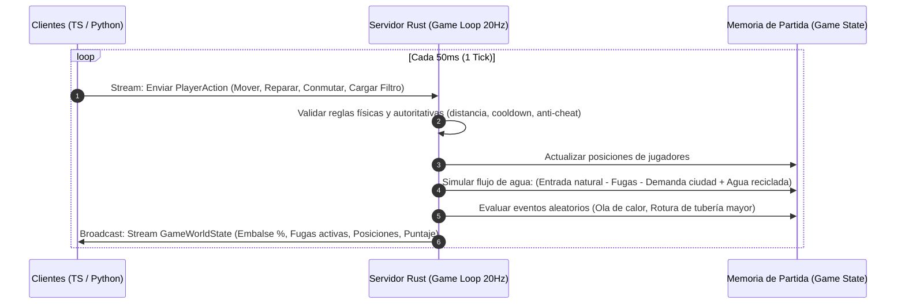

# Diseño del Juego: EcoStream 3R (Ahorro de Agua)

Proyecto para la cátedra de **Computación en la Nube (UCAB - Ingeniería en Informática)**.
Juego multijugador en tiempo real enfocado en las **3R (Reducir, Reusar y Reciclar)** y la **gestión eficiente del agua**.

---

## 1. Concepto y Premisa del Juego

**Nombre tentativo:** *EcoStream: Water Guardians (o Aqua3R)*  
**Género:** Gestión y simulación colaborativa/competitiva en tiempo real (*Top-Down Arcade Co-op* estilo *Overcooked* / *Mini Metro* / *Tower Defense colaborativo*).  
**Objetivo de la Partida:**  
Una ciudad o comunidad sufre de sequía severa. Los jugadores comparten una reserva hídrica común (**El Embalse Principal**). El objetivo es evitar que el embalse se vacíe a 0% o que la contaminación del agua supere el 100% durante una partida cronometrada (ej. 3 a 5 minutos) o por oleadas de eventos.

---

## 2. Aplicación Concreta de las 3R al Ahorro de Agua

| Las 3R | Mecánica en el Juego | Acción del Jugador | Impacto en la Simulación |
| :--- | :--- | :--- | :--- |
| **1. REDUCIR (Reduce)** | **Prevención de Fugas y Derroche**: Tuberías y grifos en fábricas o viviendas se rompen aleatoriamente con fugas de agua a alta presión. | Acercarse con herramienta de sellado / llave inglesa para cerrar válvulas y reparar fugas antes de que se pierdan miles de litros. | Frena la tasa de drenaje por segundo del embalse comunal. |
| **2. REUSAR (Reuse)** | **Desvío de Aguas Grises**: Duchas y lavadoras domésticas generan agua poco sucia (aguas grises). | Instalar o conmutar compuertas/tuberías hacia tanques de riego de cultivos y sanitarios en lugar de enviarlas al drenaje pluvial. | Ahorra agua potable pura al suplir tareas secundarias con agua recirculada. |
| **3. RECICLAR (Recycle)** | **Planta de Tratamiento & Filtros**: Las industrias generan aguas residuales contaminadas. Si van al río, contaminan todo el ecosistema. | Recolectar reactivos/filtros (carbón activo, mallas), llevarlos a la planta de purificación y operar la bomba de filtrado. | Convierte un volumen de aguas residuales en agua limpia reintegrable al embalse. |

---

## 3. Dinámica Multijugador (2 a 4 jugadores por sala)

### 3.1 Roles / Especialidades
Para fomentar la coordinación en tiempo real entre los clientes (TypeScript y Python):
1. **El Fontanero / Inspector (Reductor)**:
   - Especialista en velocidad y reparación de fisuras.
   - Detecta fugas subterráneas antes de que exploten.
2. **El Ingeniero Hidráulico (Reusador)**:
   - Administra la red de compuertas y bombas para balancear el flujo entre hogares, cultivos y almacenes.
3. **El Químico / Operador de Planta (Reciclador)**:
   - Procesa los lodos y residuos en la planta de tratamiento, optimizando los químicos y limpiando filtros atascados.

> *Nota:* Cualquiera puede realizar cualquier acción básica, pero tener roles o coordinarse divide las tareas eficientemente en partidas intensas.

---

## 4. Bucle del Juego (Game Loop en el Servidor Rust)

El servidor Rust corre a **20 Ticks/segundo (50ms por tick)**:



---

## 5. Eventos Dinámicos de Presión (Simulando la Nube y el Clima)

1. **Ola de Calor (Heatwave)**: La demanda de agua de la ciudad se duplica por 30 segundos. Los jugadores deben extremar el racionamiento y reuso de aguas grises.
2. **Rotura Crítica en Tubería Matriz**: Una fuga masiva drena el 5% del embalse por segundo si dos jugadores no coordinan para cerrar la válvula principal al mismo tiempo.
3. **Contaminación Industrial**: Si la planta de reciclaje se desborda, el agua del embalse se tiñe y la penalización de puntaje se multiplica.

---

## 6. Representación del Modelo en Protocol Buffers (gRPC)

Un adelanto de cómo se estructuran los mensajes gRPC para el juego:

```protobuf
syntax = "proto3";
package ecostream.gameplay.v1;

message PlayerAction {
  string player_id = 1;
  uint64 tick_number = 2;
  MoveAction move = 3; // Opcional, permite moverse
  repeated InteractionAction interactions = 4; // Permite ejecutar múltiples acciones 3R concurrentes a la vez (Reparar, Desviar, etc.)
}

message InteractionAction {
  enum InteractionType {
    REPAIR_PIPE = 0;
    DIVERT_VALVE = 1;
    LOAD_FILTER = 2;
  }
  InteractionType type = 1;
  string target_entity_id = 2;
}

message MoveAction {
  float target_x = 1;
  float target_y = 2;
}

message RepairPipeAction {
  uint32 pipe_id = 1;
}

message DivertValveAction {
  uint32 valve_id = 1;
  enum WaterRoute { DRAIN = 0; IRRIGATION = 1; RECYCLE_PLANT = 2; }
  WaterRoute route = 2;
}

message GameWorldState {
  uint64 tick_number = 1;
  float reservoir_level_pct = 2;   // 0.0 a 100.0%
  float water_purity_pct = 3;      // 0.0 a 100.0%
  uint32 score = 4;
  repeated PlayerState players = 5;
  repeated PipeState pipes = 6;
  repeated AlertEvent active_events = 7;
}
```

---

## 7. Experiencia en los Clientes

1. **Cliente Web en TypeScript**:
   - Renderizado con **HTML5 Canvas / PixiJS / Phaser**.
   - Muestra el mapa top-down con la presa, la ciudad, las tuberías con animaciones de agua y los avatares de los jugadores moviéndose e interactuando con controles de teclado (WASD / Flechas + Espacio para interactuar).
2. **Cliente en Python**:
   - Dos posibles modalidades:
     - **Modo CLI / TUI (Textual/Curses)**: Renderiza el mapa en caracteres ASCII / consola con barras de progreso de embalse, tuberías y estado de jugadores.
     - **Modo Agente / Bot Inteligente**: Corre en background simulando un compañero automático que busca la fuga más cercana y la repara, ideal para pruebas de carga y evaluación de la cátedra sin requerir siempre 4 personas humanas conectadas.

---

## 8. Resiliencia de Sesión y Reconexión Rápida (agregado por Victor)

Para evitar que jugadores pierdan su progreso ante microcortes de red o caídas transitorias de paquetes durante la simulación a 20 Hz:

1. **Ticket de Sesión Efímero (`reconnect_ticket`) (agregado por Victor)**:
   - Al unirse a la sala, el servidor Rust emite un token de sesión de 64 bits.
   - Si el stream gRPC se interrumpe, el servidor mantiene la entidad del jugador en la posición actual durante un margen de gracia de **5 segundos**.
2. **Snapshot de Reconciliación Inmediato (agregado por Victor)**:
   - Al reconectar con el ticket válido, el cliente no reinicia el juego: recibe un `GameWorldSnapshot` completo del tick actual y continúa el bucle de renderizado fluidamente.

