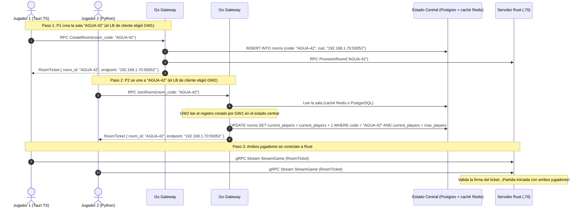

# Arquitectura de Gateways Redundantes en Equipos Distintos
## Cómo gestionan peticiones, cómo se coordinan y cómo el cliente llega a uno de ellos

Este documento explica cómo funcionan dos instancias de Gateway en Go desplegadas en **máquinas o contenedores independientes**, cómo el cliente elige a cuál conectarse y cómo se coordinan sin colisionar. El alcance general está en [ALCANCE_Y_DECISIONES.md](ALCANCE_Y_DECISIONES.md).

---

## 1. ¿Cómo llega el cliente a un gateway? (Balanceo del lado del cliente)

El cliente **no se conecta a una sola IP**: recibe la lista de réplicas y gRPC elige una. Es la estrategia adoptada para todos los entornos (LAN, Docker multi-host o nube).

```
                            CLIENTE
              (resolver gRPC: dns:///gateway.local:50051
               o lista: 192.168.1.51:50051, 192.168.1.52:50051)
                         /                 \
        Petición 1      /                   \  Petición 2
                       v                     v
          +-----------------------+    +-----------------------+
          |  MÁQUINA / CONTENEDOR A|    |  MÁQUINA / CONTENEDOR B|
          |  IP: 192.168.1.51     |    |  IP: 192.168.1.52     |
          |  [Go Gateway #1]      |    |  [Go Gateway #2]      |
          +-----------------------+    +-----------------------+
```

### Cómo funciona
- gRPC permite configurar el canal con un resolver de nombres o con varios endpoints:
  ```python
  # En Python / TypeScript
  channel = grpc.insecure_channel('dns:///gateway.local:50051')
  # o lista de réplicas: ['192.168.1.51:50051', '192.168.1.52:50051']
  ```
- El cliente reparte las peticiones entre las réplicas en round-robin.
- Si un gateway no responde (timeout o conexión rechazada), el propio canal gRPC conmuta a la otra réplica **sin que el usuario vea un error**.

### Alternativas (no se implementan)
- **IP virtual con Keepalived/VRRP**: se descarta porque una VIP oculta las réplicas detrás de una única IP y anula el balanceo nativo del cliente.
- **Balanceador L4 gestionado de nube (NLB o equivalente)**: podría sustituir al DNS sin cambiar nada más de la arquitectura.

---

## 2. ¿Cómo dos Gateways gestionan las peticiones sin pisarse?

El principio de oro para gateways en la nube es: **LOS GATEWAYS SON STATELESS (sin estado en memoria local)**.

```
       [Cliente 1] (Crea Sala)              [Cliente 2] (Se Une)
              |                                     |
              v                                     v
     +-----------------+                   +-----------------+
     | Go Gateway #1   |                   | Go Gateway #2   |
     +-----------------+                   +-----------------+
              \                                     /
               \           ESTADO COMPARTIDO       /
                v                                 v
        +--------------------------------------------------+
        |  POSTGRESQL (fuente de verdad)                   |
        |  - Tabla de salas: "AGUA-42" -> endpoint de Rust |
        |  - Reserva atómica de cupo                       |
        |  REDIS (solo caché de lectura de salas activas)  |
        +--------------------------------------------------+
                                 |
                                 v
        +--------------------------------------------------+
        |                  RUST ENGINE                     |
        |          Partida en vivo a 20 Ticks/seg          |
        +--------------------------------------------------+
```

### 2.1 Manejo de sesiones (JWT sin estado)
- Los Gateways **no guardan variables de sesión en la RAM local**.
- Cuando el Gateway #1 autentica a un usuario, genera un **token JWT firmado con HS256** usando un secreto compartido (inyectado por variable de entorno).
- Si el siguiente mensaje del usuario llega al Gateway #2, este valida la firma matemáticamente. **No necesita preguntarle al Gateway #1 quién es ese usuario**.

### 2.2 Coordinación de salas y matchmaking (PostgreSQL + caché Redis)
¿Qué ocurre si el Jugador 1 habla con el Gateway #1 para crear la sala `AGUA-42` y el Jugador 2 habla con el Gateway #2 para unirse?
1. El Gateway #1 crea el registro de la sala en **PostgreSQL**:
   ```sql
   INSERT INTO rooms (code, host_id, status, rust_endpoint)
   VALUES ('AGUA-42', 'player-1', 'WAITING', '192.168.1.70:50052');
   ```
   y la publica en la caché de Redis con un TTL.
2. Cuando el Jugador 2 consulta al Gateway #2 para unirse a `AGUA-42`:
   - El Gateway #2 lee la caché de Redis (o PostgreSQL si Redis no responde) y obtiene el endpoint del servidor Rust asignado.
   - Reserva el cupo con una operación atómica en PostgreSQL (ver 3.1).
   - Entrega al Jugador 2 el `RoomTicket` correspondiente.
3. Ambos jugadores terminan en la misma sala sin importar qué gateway los atendió.

---

## 3. ¿Cómo se coordinan los Gateways si están en equipos distintos?

Los gateways **no se comunican entre sí**. Se coordinan únicamente a través del estado compartido, lo que evita un acoplamiento de red N × N:

### 3.1 Reserva atómica de cupo en PostgreSQL
Para evitar que dos jugadores ocupen el último puesto de una sala al mismo milisegundo no se confía en la memoria de los gateways:
```sql
-- Operación atómica ejecutada por cualquier Gateway:
UPDATE rooms
SET current_players = current_players + 1
WHERE code = 'AGUA-42' AND current_players < max_players;
```
- Si la fila no se actualiza (0 filas afectadas), el Gateway sabe que la sala se llenó en ese instante y rechaza la solicitud de forma consistente.

### 3.2 Caché de lectura en Redis
- Redis solo acelera la consulta de salas activas (patrón Cache-Aside). Nunca es la fuente de verdad: si cae, los gateways leen directamente de PostgreSQL.

> [!NOTE]
> Un bus Pub/Sub entre gateways (por ejemplo, para anunciar que un worker de Rust cayó) queda como **trabajo futuro**. En el alcance actual, cada gateway sondea la salud de los workers de forma independiente.

---

## 4. Resumen Visual del Flujo Paso a Paso



---

## 5. Respuestas Concretas a las Dudas Frecuentes

1. **¿Cómo llega el cliente a un gateway?**
   - Con balanceo del lado del cliente gRPC: un nombre DNS o una lista de endpoints. Si una réplica cae, el canal conmuta a la otra.
2. **¿Cómo gestionan las peticiones sin conflicto?**
   - Son **stateless**: usan tokens **JWT** (autenticación sin memoria de sesión) y delegan la consistencia a **PostgreSQL** con operaciones atómicas (`UPDATE ... WHERE current_players < max`).
3. **¿Cómo se comunican entre equipos distintos?**
   - No se comunican directamente. Comparten el estado en **PostgreSQL** (fuente de verdad) y una **caché de salas en Redis**, de modo que se pueden agregar más gateways sin cambiar el código.
