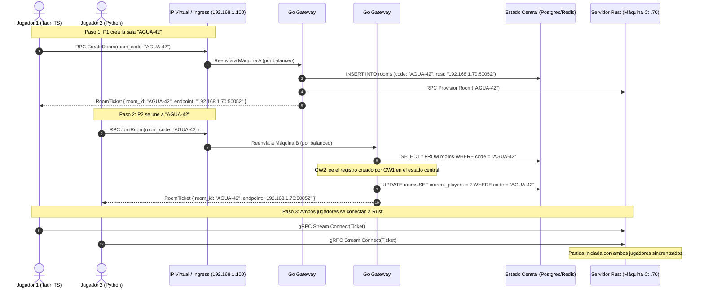

# Arquitectura de Gateways Redundantes en Equipos Distintos
## Cómo gestionan peticiones, cómo se comunican y cómo el cliente ve una sola entrada

Este documento explica de forma práctica, técnica y conceptual cómo funcionan dos instancias de Gateway en Go desplegadas en **máquinas físicas o virtuales independientes**, cómo se garantiza que el cliente perciba un único punto de acceso, y cómo se coordinan entre sí sin colisionar.

---

## 1. ¿Cómo un cliente solo ve uno de ellos? (Abstracción del Punto de Entrada)

El cliente **nunca debe conocer las direcciones IP individuales de cada máquina**. En sistemas distribuidos en la nube existen tres técnicas estándar para lograr que el cliente apunte a un solo destino:

```
                            CLIENTE
                   (Apunta a: api.ecostream.ucab.ve
                    o a la VIP: 192.168.1.100)
                               |
                               v
               +-------------------------------+
               | PUNTO DE ENTRADA UNIFICADO     |
               | (Capa L4 VIP / Proxy Ingress) |
               +-------------------------------+
                       /               \
       Petición 1     /                 \ Petición 2
                     v                   v
        +-----------------------+    +-----------------------+
        |  MÁQUINA FÍSICA A     |    |  MÁQUINA FÍSICA B     |
        |  IP: 192.168.1.51     |    |  IP: 192.168.1.52     |
        |  [Go Gateway #1]      |    |  [Go Gateway #2]      |
        +-----------------------+    +-----------------------+
```

### Mecanismo 1: Dirección IP Virtual Compartida (VIP con Keepalived / VRRP)
* **Dónde se usa:** En redes locales (LAN), centros de datos de la UCAB o servidores propios (Bare-metal).
* **Cómo funciona:**
  - La Máquina A tiene su IP física real (`192.168.1.51`).
  - La Máquina B tiene su IP física real (`192.168.1.52`).
  - Ambas corren un demonio estándar llamado **`keepalived`** que negocia una **IP Virtual Flotante (VIP)**: `192.168.1.100`.
  - El cliente configura únicamente `GATEWAY_HOST=192.168.1.100`.
  - La Máquina A (Master) responde por esa IP. Si la Máquina A se apaga, desenchufa o colapsa, en menos de **800 milisegundos** la Máquina B (Backup) reclama la IP `192.168.1.100` mediante un mensaje ARP gratuito. El cliente ni siquiera nota el cambio físico.

### Mecanismo 2: Ingress / Balanceador de Carga Gestionado (Cloud Load Balancer)
* **Dónde se usa:** En la nube (AWS NLB/ALB, Google Cloud Load Balancing, DigitalOcean LB).
* **Cómo funciona:**
  - El proveedor de nube te asigna una sola dirección pública o nombre de dominio (`api.ecostream.com`).
  - El balanceador recibe el tráfico y lo reparte entre la Máquina A y la Máquina B usando Round-Robin o menor cantidad de conexiones activas (*Least Connections*).

### Mecanismo 3: Client-Side Load Balancing (Nativo en gRPC)
* **Dónde se usa:** Integrado directamente en el código de TypeScript y Python.
* **Cómo funciona:**
  - gRPC permite configurar un canal con un resolver de nombres o múltiples endpoints:
    ```python
    # En Python / TypeScript
    channel = grpc.insecure_channel('dns:///gateway.local:50051') 
    # o lista de réplicas: ['192.168.1.51:50051', '192.168.1.52:50051']
    ```
  - Si el cliente envía una petición y la Máquina A no responde (timeout TCP), el propio cliente gRPC conmuta internamente a la Máquina B sin lanzar error al usuario.

---

## 2. ¿Cómo dos Gateways en equipos distintos gestionan las peticiones sin pisarse?

El principio de oro en computación en la nube para gateways es: **LOS GATEWAYS SON STATELESS (Sin Estado en Memoria Local)**.

```
       [Cliente 1] (Crea Sala)              [Cliente 2] (Se Une)
              |                                     |
              v                                     v
     +-----------------+                   +-----------------+
     | Go Gateway #1   |                   | Go Gateway #2   |
     | (Máquina A)     |                   | (Máquina B)     |
     +-----------------+                   +-----------------+
              \                                     /
               \         ESTADO COMPARTIDO         /
                v       (Coordinación Central)    v
        +--------------------------------------------------+
        |                 REDIS / POSTGRESQL               |
        |  - Tabla de Salas: Sala "AGUA-42" -> Worker Rust |
        |  - Bloqueos Atómicos (Distributed Mutex)         |
        |  - Tokens JWT: Validados por misma clave pública |
        +--------------------------------------------------+
                                 |
                                 v
        +--------------------------------------------------+
        |            RUST ENGINE (MÁQUINA C o D)           |
        |          Partida en vivo a 20 Ticks/seg          |
        +--------------------------------------------------+
```

### 1. Manejo de Sesiones (Stateless JWT)
- Los Gateways **no guardan variables de sesión en memoria RAM local**.
- Cuando el Gateway #1 en la Máquina A autentica a un usuario, genera un **Token JWT** firmado criptográficamente con una clave compartida (clave simétrica HMAC o clave asimétrica Ed25519).
- Si el siguiente mensaje del usuario llega al Gateway #2 en la Máquina B, este último valida la firma criptográfica del token matemáticamente. **No necesita preguntarle a la Máquina A quién es ese usuario**.

### 2. Coordinación de Salas y Matchmaking (Base de Datos / Redis)
¿Qué ocurre si el Jugador 1 habla con la Máquina A para crear la sala `AGUA-42`, y el Jugador 2 habla con la Máquina B para unirse a ella?
1. El Gateway #1 crea el registro de la sala en la base de datos común (**PostgreSQL** o **Redis** compartido):
   ```sql
   INSERT INTO rooms (code, host_id, status, rust_endpoint) 
   VALUES ('AGUA-42', 'player-1', 'WAITING', '192.168.1.70:50052');
   ```
2. Cuando el Jugador 2 consulta a la Máquina B para unirse a `AGUA-42`:
   - El Gateway #2 consulta la misma base de datos/Redis compartido.
   - Lee que la sala existe, que tiene cupo disponible y cuál es la IP del servidor Rust asignado.
   - Gateway #2 actualiza la sala y le entrega al Jugador 2 el `RoomTicket` correspondiente.
3. Ambos jugadores terminan jugando en la misma sala sin importar qué máquina los atendió.

---

## 3. ¿Cómo se comunican los Gateways entre sí si están en equipos distintos?

Los gateways en la nube **no suelen comunicarse punto a punto directamente** (lo que crearía un acoplamiento rígido de red $N \times N$), sino que utilizan dos patrones canónicos:

```
  +------------------+                          +------------------+
  |  Go Gateway #1   |                          |  Go Gateway #2   |
  |  (Máquina A)     |                          |  (Máquina B)     |
  +------------------+                          +------------------+
        |      ^                                      |      ^
Pub Msg |      | Sub Eventos                  Pub Msg |      | Sub Eventos
        v      |                                      v      |
  +----------------------------------------------------------------+
  |              BUS DE MENSAJERÍA / PUB-SUB (Redis)               |
  | Canal: "events.rooms" | Canal: "system.heartbeats"             |
  +----------------------------------------------------------------+
```

### 1. Patrón Pub/Sub (Publicador / Suscriptor)
- Ambas máquinas se suscriben a un canal común en Redis o NATS:
  - Si el Gateway #1 registra que un servidor Rust se cayó, publica un evento en el canal `system.alerts`:
    ```json
    { "event": "RUST_WORKER_DOWN", "worker_id": "rust-01" }
    ```
  - El Gateway #2 en la Máquina B lo recibe instantáneamente en su hilo de suscripción y actualiza su lista de servidores disponibles.

### 2. Sincronización Transaccional en Base de Datos (PostgreSQL)
- Para cambios críticos (como evitar que dos jugadores ocupen el último puesto de una sala al mismo milisegundo), no se confía en la memoria de los gateways.
- Se utiliza la garantía transaccional de PostgreSQL con niveles de aislamiento:
  ```sql
  -- Operación atómica ejecutada por cualquier Gateway:
  UPDATE rooms 
  SET current_players = current_players + 1 
  WHERE code = 'AGUA-42' AND current_players < max_players;
  ```
- Si la fila no se actualiza (retorna 0 filas afectadas), el Gateway sabe que la sala se llenó en ese instante y rechaza la solicitud de forma consistente.

---

## 4. Resumen Visual del Flujo Paso a Paso



---

## 5. Respuestas Concretas a tus Dudas

1. **¿Cómo el cliente ve solo un gateway?**
   - El cliente se conecta a un **nombre de dominio** o a una **IP Virtual Flotante (VIP)** gestionada por `keepalived` o un balanceador L4/L7. El cliente nunca conoce las IPs reales de las máquinas backend.
2. **¿Cómo gestionan las peticiones sin conflicto?**
   - Son **Stateless**: usan tokens **JWT** (autenticación sin memoria de sesión) y delegan la consistencia a **PostgreSQL/Redis** con operaciones atómicas (`UPDATE ... WHERE current_players < max`).
3. **¿Cómo se comunican entre equipos distintos?**
   - No tienen cables directos entre sí. Se coordinan a través de la **base de datos común** y canales de mensajería **Pub/Sub** (Redis), garantizando que el sistema escale horizontalmente agregando 2, 5 o 10 gateways sin cambiar una sola línea de código.
