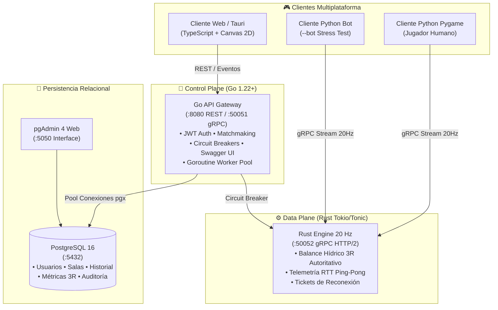

# 🛠️ Guía Maestra de Despliegue, Pruebas y Manual de Usuario

> **Proyecto:** EcoStream 3R - AquaGuardians 💧🌱  
> **Cátedra:** Computación en la Nube  
> **Institución:** Universidad Católica Andrés Bello (UCAB)  
> **Estado del Proyecto:** Fases 0 a 5 Completadas al 100%  

---

## 📋 Índice Rápido
1. [Visión General del Sistema](#-1-visión-general-del-sistema)
2. [Prerrequisitos del Entorno](#-2-prerrequisitos-del-entorno)
3. [Paso 1: Levantar los Servicios en Docker](#-3-paso-1-levantar-los-servicios-en-docker-un-solo-comando)
4. [Paso 2: Verificación de Salud e Interfaces de Gestión](#-4-paso-2-verificación-de-salud-e-interfaces-de-gestión)
5. [Paso 3: Ejecución de Clientes de Videojuego](#-5-paso-3-ejecución-de-clientes-de-videojuego)
   - [Cliente 1: Python Pygame (Modo Jugador Humano)](#31-cliente-gráfico-en-python-modo-jugador-humano)
   - [Cliente 2: Python Pygame (Modo Bot Autónomo para Stress Testing)](#32-cliente-python-modo-bot-autónomo-stress-testing)
   - [Cliente 3: Web / Tauri (TypeScript + Canvas 2D)](#33-cliente-web--tauri-typescript--canvas-2d)
6. [Paso 4: Ejecución de la Suite de Pruebas Automatizadas](#-6-paso-4-ejecución-de-la-suite-de-pruebas-automatizadas)
7. [Catálogo Completo de Scripts y Utilidades](#-7-catálogo-completo-de-scripts-y-utilidades)
8. [Preguntas Frecuentes y Solución de Problemas (Troubleshooting)](#-8-preguntas-frecuentes-y-solución-de-problemas-troubleshooting)

---

## 🏗️ 1. Visión General del Sistema

EcoStream 3R está construido bajo una arquitectura políglota distribuida en microservicios, orientada a eventos hídricos y streaming en tiempo real a **20 Hz**:



---

## 💻 2. Prerrequisitos del Entorno

Para ejecutar y probar la totalidad del sistema necesitas tener instalado:

1. **Docker Desktop:** [Descargar Docker](https://www.docker.com/products/docker-desktop/) (debe estar abierto y en ejecución).
2. **Python 3.10 o superior:** [Descargar Python](https://www.python.org/downloads/) (marca la casilla *"Add python.exe to PATH"*).
3. **Node.js 18+ con npm:** [Descargar Node.js](https://nodejs.org/) (necesario solo para ejecutar el cliente Web/Tauri).
4. **Git:** Para clonar y gestionar el repositorio.

### Instalación Rápida de Dependencias Python
Abre tu terminal en la raíz del proyecto y ejecuta:
```powershell
pip install -r requirements.txt
```
*(Instala `grpcio`, `grpcio-tools`, `protobuf`, `pygame-ce` y `requests` automáticamente).*

---

## 🐳 3. Paso 1: Levantar los Servicios en Docker (Un solo comando)

Abre una terminal PowerShell o Bash en la raíz del proyecto [`ecostream-3r`](file:///c:/Users/freit/OneDrive/Escritorio/University/ecostream-3r/) y ejecuta:

```powershell
docker compose -f deployments/docker-compose.yml up -d --build
```

Docker construirá y levantará automáticamente los siguientes contenedores interconectados en la red privada `ecostream-net`:

| Contenedor / Servicio | Tecnología | Puerto Mapeado | Propósito |
| :--- | :--- | :--- | :--- |
| **`ecostream-postgres`** | PostgreSQL 16 Alpine | `localhost:5432` | Base de datos relacional con esquema DDL, índices y datos iniciales aplicados. |
| **`ecostream-gateway`** | Go 1.22+ Alpine | `http://localhost:8080`<br>`localhost:50051` | Control plane, autenticación JWT, salas stateless, worker pools de Goroutines y Swagger. |
| **`ecostream-engine-rust`** | Rust (Tokio/Tonic) | `localhost:50052` | Data plane con streaming bidireccional gRPC a 20 Hz y bucle autoritativo de balance hídrico. |
| **`ecostream-pgadmin`** | pgAdmin 4 | `http://localhost:5050` | Interfaz gráfica web para explorar tablas y registros de PostgreSQL. |

---

## 🩺 4. Paso 2: Verificación de Salud e Interfaces de Gestión

Una vez levantado Docker, puedes abrir los siguientes enlaces en tu navegador para verificar el estado de los componentes:

### 1. Documentación Interactiva Swagger / OpenAPI
* **URL:** [http://localhost:8080/swagger/](http://localhost:8080/swagger/)
* **Descripción:** Permite probar directamente los endpoints REST de autenticación (`/api/v1/auth/register`, `/api/v1/auth/login`) y matchmaking (`/api/v1/rooms/create`, `/api/v1/rooms/join`, `/api/v1/rooms/list`).

### 2. Probes de Salud Cloud-Native
* **Liveness:** [http://localhost:8080/healthz](http://localhost:8080/healthz) $\rightarrow$ Retorna `{"status":"UP","service":"ecostream-gateway"}`.
* **Readiness:** [http://localhost:8080/readyz](http://localhost:8080/readyz) $\rightarrow$ Retorna `{"status":"READY","database":"UP"}` (verifica el pool de PostgreSQL).

### 3. Panel de Base de Datos pgAdmin 4
* **URL:** [http://localhost:5050](http://localhost:5050)
* **Credenciales de Acceso:**
  * **Email:** `admin@ecostream.ucab.ve`
  * **Contraseña:** `admin123`
* **Para conectar el servidor de BD en pgAdmin:**
  * Host: `postgres`
  * Puerto: `5432`
  * Mantenimiento BD: `ecostream_db`
  * Usuario: `ecostream_user`
  * Contraseña: `ecostream_secure_pass`

---

## 🎮 5. Paso 3: Ejecución de Clientes de Videojuego

### 3.1. Cliente Gráfico en Python (Modo Jugador Humano)
Conéctate directamente al motor en Rust a 20 Hz para jugar interactivamente:

```powershell
python client-python/main_game.py
```

* **Mapeo de Controles:**
  * `W, A, S, D` o `Flechas`: Mover el avatar del AquaGuardian por el mapa.
  * `Espacio`: **1. REDUCIR:** Reparar la fuga de agua a presión más cercana (genera chispas de soldadura, sella la rotura y suma puntos).
  * `R`: **2. REUSAR:** Conmutar compuertas para canalizar aguas grises al huerto comunitario de riego.
  * `F`: **3. RECICLAR:** Cargar filtros biológicos de carbón activo y UV en la planta de tratamiento para restaurar la pureza del agua.
  * `ESC`: Salir de la partida.

---

### 3.2. Cliente Python en Modo Bot Autónomo (Stress Testing)
Ejecuta un agente inteligente con IA que patrulla el mapa, detecta roturas críticas y repara fugas automáticamente:

```powershell
python client-python/main_game.py --bot
```
* **Utilidad:** Permite a los evaluadores de la cátedra comprobar la estabilidad del streaming a 20 Hz, la reactividad del servidor Rust y la recolección de telemetría de latencia RTT en tiempo real sin requerir interacción manual.

---

### 3.3. Cliente Web / Tauri (TypeScript + Canvas 2D)
Para ejecutar la interfaz gráfica basada en navegador / escritorio:

```powershell
# 1. Entrar al directorio del cliente
cd client-tauri

# 2. Instalar dependencias (solo la primera vez)
npm install

# 3. Iniciar servidor de desarrollo Vite
npm run dev
```
* Abre **[http://localhost:5173](http://localhost:5173)** en tu navegador.
* **Características:** Ondas sinusoidales realistas en el embalse, sistema de partículas de agua y soldadura, sintetizador de audio procedural nativo con Web Audio API (botón 🔊 para activar/silenciar) y controles mediante botones táctiles o teclado (`WASD`, `Espacio`, `R`, `F`).

---

## 🧪 6. Paso 4: Ejecución de la Suite de Pruebas Automatizadas

El proyecto incluye suites de pruebas automatizadas para validar contratos de red y comunicación en vivo:

### A. Validación Unitaria de Contratos Protobuf y OpenAPI
Valida la serialización binaria de todas las acciones 3R (`RepairPipe`, `DivertValve`, `OperateRecycle`), la estructura del estado `GameWorldState` a 20 Hz y la integridad de OpenAPI 3.0:

```powershell
python scripts/test_contracts.py
```
* **Resultado Esperado:** `TODAS LAS PRUEBAS DE CONTRATOS PASARON EXITOSAMENTE (5/5)`.

---

### B. Prueba de Integración End-to-End en Vivo
Ejecuta una prueba completa de ciclo de vida con autenticación JWT, creación de sala en el Gateway y streaming de simulación en tiempo real a 20 Ticks/segundo con telemetría de latencia Ping-Pong:

```powershell
python scripts/test_live_grpc.py
```
* **Resultado Esperado:**
  * Login simulado exitoso con token JWT generado.
  * Sala creada con ticket de emparejamiento.
  * Streaming continuo a 20 Hz con latencia RTT calculada (~1-3 ms en local).

---

## 📜 7. Catálogo Completo de Scripts y Utilidades

| Archivo / Script | Ruta | Descripción | Comando |
| :--- | :--- | :--- | :--- |
| **`main_game.py`** | [`client-python/main_game.py`](../client-python/main_game.py) | Cliente de juego Pygame con soporte interactivo y flag `--bot`. | `python client-python/main_game.py [--bot]` |
| **`build_protos.py`** | [`scripts/build_protos.py`](../scripts/build_protos.py) | Compilador automatizado de Protocol Buffers que genera stubs de Python y sincroniza definiciones para Rust. | `python scripts/build_protos.py` |
| **`test_contracts.py`** | [`scripts/test_contracts.py`](../scripts/test_contracts.py) | Suite de pruebas de contratos gRPC y serialización binaria 3R. | `python scripts/test_contracts.py` |
| **`test_live_grpc.py`** | [`scripts/test_live_grpc.py`](../scripts/test_live_grpc.py) | Prueba de integración de streaming a 20 Hz y RTT en vivo. | `python scripts/test_live_grpc.py` |
| **`mock_server.py`** | [`client-python/mock_server.py`](../client-python/mock_server.py) | Servidor simulador standalone en Python en el puerto `50051`. | `python client-python/mock_server.py` |
| **`test_client.py`** | [`client-python/test_client.py`](../client-python/test_client.py) | Cliente ligero de consola para telemetría gRPC. | `python client-python/test_client.py` |

---

## ❓ 8. Preguntas Frecuentes y Solución de Problemas (Troubleshooting)

### Q1: Error al ejecutar `docker compose` indicando que el daemon no responde
* **Causa:** Docker Desktop no está iniciado o se encuentra iniciando.
* **Solución:** Abre la aplicación **Docker Desktop** en tu barra de tareas, espera que el icono se ponga en verde (Engine Running) y vuelve a ejecutar el comando.

### Q2: Error de importación en Python (`ModuleNotFoundError: No module named 'pygame'`)
* **Solución:** Ejecuta `pip install -r requirements.txt`. En entornos con Python 3.12+ o 3.14, `pygame-ce` (Community Edition) es la versión recomendada y totalmente compatible.

### Q3: Conflicto de puerto (Ej. `Port 5432 is already in use`)
* **Causa:** Hay un servicio de PostgreSQL local corriendo en tu máquina host.
* **Solución:** Puedes detener temporalmente el servicio de Postgres local (`net stop postgresql-x64-16` en Windows o detenerlo desde `services.msc`), o modificar el puerto externo en `deployments/docker-compose.yml` (por ejemplo `"5433:5432"`).

### Q4: ¿Cómo detener todos los servicios de Docker al finalizar?
* **Comando:**
  ```powershell
  docker compose -f deployments/docker-compose.yml down
  ```
  *(Si deseas además limpiar los volúmenes de datos temporales, agrega `-v`: `docker compose -f deployments/docker-compose.yml down -v`)*.

---

### 📚 Enlaces de Referencia del Proyecto
* 📊 [AVANCES_PROYECTO.md](AVANCES_PROYECTO.md): Bitácora de seguimiento por fases del plan de trabajo.
* 🏛️ [ARQUITECTURA_Y_PLANIFICACION.md](ARQUITECTURA_Y_PLANIFICACION.md): Documentación técnica sobre Zero-SPOF, patrones Cloud-Native y Worker Pools en Go.
* 🎮 [DISENO_DEL_JUEGO.md](DISENO_DEL_JUEGO.md): Documento de diseño del juego, balance hídrico y mecánicas 3R.
* 🎨 [PROMPTS_DISENO_SPRITES.md](PROMPTS_DISENO_SPRITES.md): Guía de prompts para generación de arte y tilesets Pixel Art.
