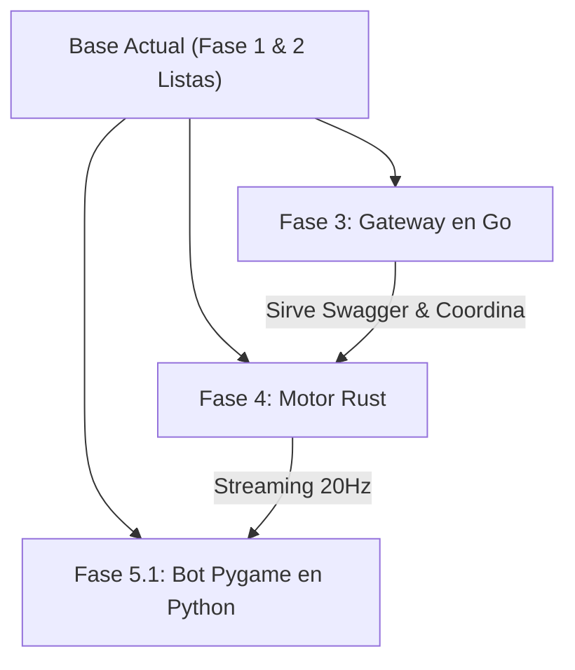

# 🛠️ Guía de Scripts, Despliegue de Pruebas y Próximos Pasos

> **Proyecto:** EcoStream 3R - AquaGuardians 💧🌱  
> **Cátedra:** Computación en la Nube (UCAB)  
> **Estado:** Fase 1 & 2 Completadas  

---

## 📜 1. Catálogo de Scripts y Funcionalidades

El proyecto cuenta con scripts automatizados en `scripts/` y `client-python/` diseñados para ser ejecutados de forma portable en Windows, Linux o macOS:

| Script / Archivo | Ubicación | Funcionalidad Principal | Cómo se ejecuta |
| :--- | :--- | :--- | :--- |
| **`build_protos.py`** | [`scripts/build_protos.py`](../scripts/build_protos.py) | **Compilador de Protocol Buffers:** Instala automáticamente `grpcio-tools`, compila todos los archivos `.proto` a stubs de Python tipados (`*_pb2.py`, `*.pyi`) y sincroniza los contratos para el motor de Rust. | `python scripts/build_protos.py` |
| **`test_contracts.py`** | [`scripts/test_contracts.py`](../scripts/test_contracts.py) | **Suite de Validación de Contratos:** Verifica la serialización binaria de las acciones 3R (Reducir, Reusar, Reciclar), la estructura del `GameWorldState` a 20 Hz, el cálculo de latencia RTT y la validez de la especificación OpenAPI 3.0. | `python scripts/test_contracts.py` |
| **`test_live_grpc.py`** | [`scripts/test_live_grpc.py`](../scripts/test_live_grpc.py) | **Test de Integración en Vivo:** Levanta un servidor gRPC en background y ejecuta un cliente interactivo que simula el ciclo de vida completo: Login JWT, Matchmaking (Lobby `AGUA42`) y streaming continuo a 20 Hz con Ping-Pong de telemetría. | `python scripts/test_live_grpc.py` |
| **`mock_server.py`** | [`client-python/mock_server.py`](../client-python/mock_server.py) | **Servidor Simulado Standalone:** Servidor gRPC que implementa los servicios `AuthService`, `MatchmakingService` y `GameSimulationService` en el puerto `50051`. Útil para desarrollar clientes sin depender de Go o Rust. | `python client-python/mock_server.py` |
| **`test_client.py`** | [`client-python/test_client.py`](../client-python/test_client.py) | **Cliente Interactivo de Consola:** Se conecta a un servidor gRPC, despacha acciones hídricas en tiempo real y calcula la latencia en vivo (RTT) en milisegundos. | `python client-python/test_client.py` |

---

## 🚀 2. Guía Paso a Paso de Despliegue y Ejecución Local

### Prerrequisitos
1. **Python 3.10+** (instalado y en el PATH).
2. **Docker Desktop** (abierto y en ejecución si se desea probar la base de datos).

---

### Paso 2.1: Levantar la Persistencia (PostgreSQL 16 & pgAdmin)
Abre una terminal en la raíz del proyecto y ejecuta:
```powershell
docker compose -f deployments/docker-compose.yml up -d
```

* **PostgreSQL:** Corriendo en `localhost:5432` (Base de datos: `ecostream_db`, Usuario: `ecostream_user`, Pass: `ecostream_secure_pass`).
* **pgAdmin 4:** Accesible en [http://localhost:5050](http://localhost:5050)
  * **Email:** `admin@ecostream.ucab.ve`
  * **Password:** `admin123`
  * **Para conectar el servidor en pgAdmin:** Host: `postgres`, Puerto: `5432`, DB: `ecostream_db`, User: `ecostream_user`.

---

### Paso 2.2: Recompilar Protocol Buffers (Opcional si modificas algún `.proto`)
Si agregas nuevos campos o mensajes en `proto/ecostream/v1/`:
```powershell
python scripts/build_protos.py
```

---

### Paso 2.3: Ejecutar la Suite de Pruebas Unitarias de Contratos
Valida que la serialización gRPC y especificación OpenAPI funcionen:
```powershell
python scripts/test_contracts.py
```

---

### Paso 2.4: Ejecutar la Prueba Integrada Cliente-Servidor en Vivo
Para ver la simulación en tiempo real a 20 Ticks/segundo y telemetría RTT:
```powershell
python scripts/test_live_grpc.py
```

*(O de forma separada: Terminal 1: `python client-python/mock_server.py` y Terminal 2: `python client-python/test_client.py`)*.

---

## 🗺️ 3. Cómo Continuar desde este Punto (Ruta para la Siguiente Sesión)

El proyecto se encuentra en un punto ideal de transición: los contratos y la persistencia están listos. A partir de aquí, las opciones de desarrollo son:



### 1. Iniciar Fase 3: Gateway y Orquestador en Go
* Inicializar `go mod init github.com/Makmadon/ecostream-3r/gateway-go` en `gateway-go/`.
* Conectar el Gateway a PostgreSQL 16 usando el esquema `deployments/postgres/schema.sql`.
* Servir **Swagger UI** en `http://localhost:8080/swagger/` incrustando `docs/swagger/openapi.json`.
* Implementar los endpoints de salud `/healthz` y `/readyz` con monitoreo de goroutines.

### 2. Iniciar Fase 4: Motor de Simulación en Rust
* Inicializar proyecto Cargo en `engine-rust/` con dependencias `tonic`, `tokio`, `prost`.
* Configurar `build.rs` para compilar los `.proto` de `engine-rust/proto/`.
* Implementar el bucle autoritativo de 20 Hz con la lógica de balance hídrico del embalse.

### 3. Iniciar Fase 5: Cliente Pygame / Bot en Python
* Crear `client-python/main_game.py` con ventana Pygame renderizando el embalse, las tuberías con fugas y los controles de teclado.
* Conectar Pygame al stream gRPC utilizando los stubs ya generados en `client-python/proto/`.
