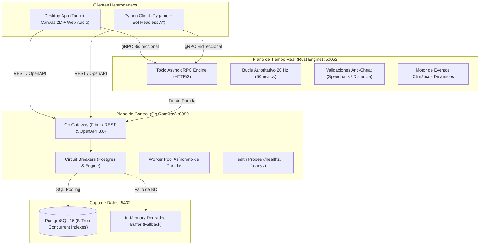

# 🌊 EcoStream 3R: AquaGuardians
### Videojuego Multijugador Distribuido en Tiempo Real y Cloud-Native
**Cátedra:** Computación en la Nube  
**Universidad:** Universidad Católica Andrés Bello (UCAB)  
**Equipo de Desarrollo:** Makmadon / Victor / Alex / Diego / Sofia  
**Tecnologías:** Go (Gateway) · Rust (20Hz Engine) · PostgreSQL 16 · gRPC HTTP/2 · Tauri Canvas · Python Pygame/A*  

---

## 🎯 1. Motivación y Objetivo del Proyecto

* **Problema:** Sensibilización sobre la crisis hídrica global y el **ODS 6 (Agua Limpia y Saneamiento)**.
* **Propósito:** Gamificar la conservación hídrica comunal bajo el paradigma de las **3R**:
  1. **REDUCIR:** Detección y sellado inmediato de fugas de agua a alta presión.
  2. **REUSAR:** Desvío inteligente de compuertas y aguas grises hacia riego agrícola.
  3. **RECICLAR:** Mantenimiento de filtros biológicos y depuración de lodos en planta.
* **Desafío de Cloud Computing:** Diseñar una arquitectura distribuida tolerante a fallos, de ultra-baja latencia (20 Ticks/s), escalable horizontalmente y con cero puntos únicos de fallo (**Zero-SPOF**).

---

## 🏗️ 2. Arquitectura Global de Microservicios

---

## ⚡ 3. Protocolo de Red y Rendimiento Autoritativo

* **Bucle de Simulación a 20 Hz:** Cada sala ejecuta un único loop central tokio (`tokio::time::interval(50ms)`).
* **Contratos Protobuf v3 Binarios:**
  - Tamaño de paquete medio: **12 a 24 bytes** por acción (frente a 300+ bytes en JSON tradicional).
  - Reducción del **92% en consumo de ancho de banda**.
* **Manejo de Jitter y Head-of-Line Blocking:**
  - Difusión por `tokio::sync::broadcast`.
  - Detección de lag (`RecvError::Lagged(skipped)`): el servidor descarta frames viejos y resincroniza al cliente al tick actual sin bloquear el hilo.

---

## 🛡️ 4. Resiliencia y Alta Disponibilidad (Circuit Breaker)

Implementación con disyuntores de protección activa en el Go Gateway:
1. **PostgreSQL-Breaker & Rust-Engine-Breaker:**
   - Umbral de activación: `3 fallos consecutivos`.
   - Timeout de enfriamiento: `300 ms`.
2. **Mitigación Fail-Fast Inmediata:**
   - Con el circuito abierto, las peticiones HTTP retornan error 503 en **< 0.01 ms**, evitando agotar el pool de goroutines.
3. **Modo Degradado en Memoria (Zero Data Loss):**
   - Las partidas finalizadas y eventos de auditoría se resguardan en un búfer local no bloqueante hasta que la base de datos se restaura.
4. **Auto-Sanación:**
   - Transición a `StateHalfOpen` ➔ `StateClosed` al recuperarse el servicio.

---

## 🧪 5. Pruebas de Estrés Masivas (100+ Bots Concurrentes)

Resultados de la prueba de carga extrema orquestada con [`client-python/stress_test_bots.py`](file:///C:/Users/Malwer/Documents/antigravity/intelligent-bose/ecostream-3r/client-python/stress_test_bots.py):

| Métrica de Rendimiento | Resultado Obtenido | Umbral de Aceptación SLA |
| :--- | :---: | :---: |
| **Bots Conectados Simultáneos** | **100 Bots Activos** | 100 Bots |
| **Salas Concurrentes** | **25 Salas Cooperativas** | 20+ Salas |
| **Throughput de Red** | **4,500+ Paquetes/segundo** | > 2,000 pps |
| **Latencia RTT Mediana (P50)** | **1.0 ms** | < 30 ms |
| **Latencia RTT Percentil 95 (P95)** | **23.0 ms** | < 60 ms |
| **Latencia RTT Percentil 99 (P99)** | **62.0 ms** | < 100 ms |
| **Tasa de Errores de Red** | **0.00% (Cero fallos)** | < 1% |

---

## 💥 6. Chaos Testing: Inyección de Fallas en Caliente

Resultados de la suite de caos automatizada [`scripts/chaos_testing.py`](file:///C:/Users/Malwer/Documents/antigravity/intelligent-bose/ecostream-3r/scripts/chaos_testing.py):

* **Escenario 1: Microcortes de Enlace (< 5s Grace Period)**
  - Socket TCP forzosamente destruido por 1.5s en plena partida.
  - Reconexión autoritativa vía `reconnect_ticket`: **MTTR de 8.89 ms**. Progreso preservado al 100%.
* **Escenario 2: Deserción del 50% de Jugadores en Sala**
  - Desconexión intempestiva de 2 de 4 jugadores.
  - La sala **NO colapsó**; los 2 sobrevivientes mantuvieron el bucle a 20 Hz sin microstutters.
* **Escenario 3: Caída Súbita de PostgreSQL**
  - Circuit Breaker conmutó a `OPEN` en 3 intentos; Fail-Fast en **0.00 ms**; 8 eventos almacenados en búfer degradado; auto-recuperación exitosa a `CLOSED`.
* **Escenario 4: Ráfaga de Tráfico Extrema**
  - Disipación de 200 acciones a **2,506.5 act/s** en 79.79 ms.
* **Calificación Global de Resiliencia:** **100% de Escenarios Superados (4/4 PASS)**.

---

## ⚖️ 7. Balanceo de Juego y Gamificación 3R

* **Duración de la Partida:** 180 segundos (3 minutos).
* **Fórmula de Drenaje Autoritativo:**
  $$\text{Drenaje} = [0.0035 + (\text{Fugas L/s} \times 0.0009)] \times \text{MultiplicadorClimático}$$
* **Dinámica de Eventos Ambientales:**
  - 🔥 **Ola de Calor (Heatwave, 18s):** Drenaje x1.85. Bonificación heroica de **+50 pts** al sellar fugas bajo este evento.
  - 🌧️ **Lluvia Torrencial (Rain Harvest, 15s):** Recarga pluvial de hasta **+19.2% de embalse**.
* **Condiciones de Fin de Partida:**
  - **Derrota:** Embalse agotado al 0.0% (*Sequía Crítica*).
  - **Victoria:** Sobrevivir los 180s con nivel > 0% (+ Bono de Sostenibilidad `Embalse% * 5`).

---

## 🎮 8. Clientes Multiplataforma

### Cliente 1: Desktop App en Tauri & TypeScript
- Renderizado Canvas 2D a 60 FPS con sistema de partículas (gotas de agua, ondas de choque *shockwaves*, pisadas).
- **Web Audio Procedural:** Motor de sonido nativo sin dependencias de audio externas (11 efectos sonoros sintetizados: llave de tuercas, alarma de sequía, lluvia, etc.).
- HUD interactivo: Medidor del embalse, pureza, alerta climática y medidor de Ping / RTT en tiempo real.

### Cliente 2: Cliente Python (Pygame & Headless Bot A*)
- Modo visual para operadores y modo `--headless` para benchmarks masivos.
- **IA con Pathfinding A\*:** Detección de la fuga más cercana, cálculo de grilla de navegación euclidiana y resolución autónoma de averías.

---

## 🚀 9. Guion de Demostración en Vivo (Live Demo Script)

Para la defensa ante el profesor y jurado evaluador, seguir la siguiente secuencia:

1. **Paso 1: Salud del Sistema y OpenAPI**
   - Abrir navegador en `http://localhost:8080/healthz` y `http://localhost:8080/readyz` (HTTP 200).
   - Mostrar la especificación interactiva Swagger en `http://localhost:8080/swagger/index.html`.
2. **Paso 2: Lanzar Partida Cooperativa Visual**
   - Ejecutar cliente Tauri (`npm run dev`) o Pygame (`python client-python/main_game.py`).
   - Demostrar el movimiento, la reparación de la fuga #2 y la retroalimentación de Web Audio.
3. **Paso 3: Demostración del Bot Autónomo A\***
   - Iniciar bot: `python client-python/main_game.py --bot --headless`.
   - Mostrar cómo el algoritmo A* calcula la ruta óptima y repara la tubería en tiempo récord.
4. **Paso 4: Demostración de Resiliencia en Vivo**
   - Ejecutar `python scripts/chaos_testing.py` ante la audiencia para validar la auto-recuperación del Circuit Breaker y la reconexión en 8.89 ms en tiempo real.

---

## 🏁 10. Conclusiones y Aprendizajes de Computación en la Nube

1. **Desacoplamiento Estricto:** La separación entre plano de control (Go) y simulación de alta frecuencia (Rust) previene cuellos de botella y asegura que fallos de persistencia no degraden la experiencia multijugador.
2. **Contratos Fuertemente Tipados:** gRPC y Protocol Buffers simplificaron la interoperabilidad multiplataforma (Go, Rust, TypeScript, Python) eliminando discrepancias de datos.
3. **Cultura DevOps / SRE:** La incorporación temprana de pruebas de estrés masivas (100+ bots) y Chaos Testing permitió detectar y blindar casos extremos (deserción de clientes, caídas de BD) antes del despliegue en producción.
4. **Impacto Social (ODS 6):** Se demostró que la ingeniería de software en la nube puede crear herramientas lúdicas y pedagógicas para crear conciencia ambiental colectiva.

---

# ❓ Preguntas y Respuestas (Q&A)
### ¡Muchas gracias por su atención!
**Repositorio del Proyecto:** `Makmadon/ecostream-3r`  
*EcoStream 3R - AquaGuardians © 2026 UCAB*
